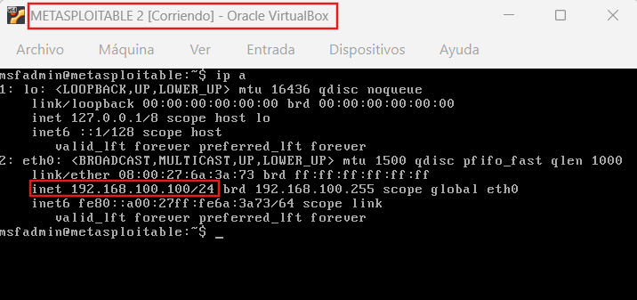
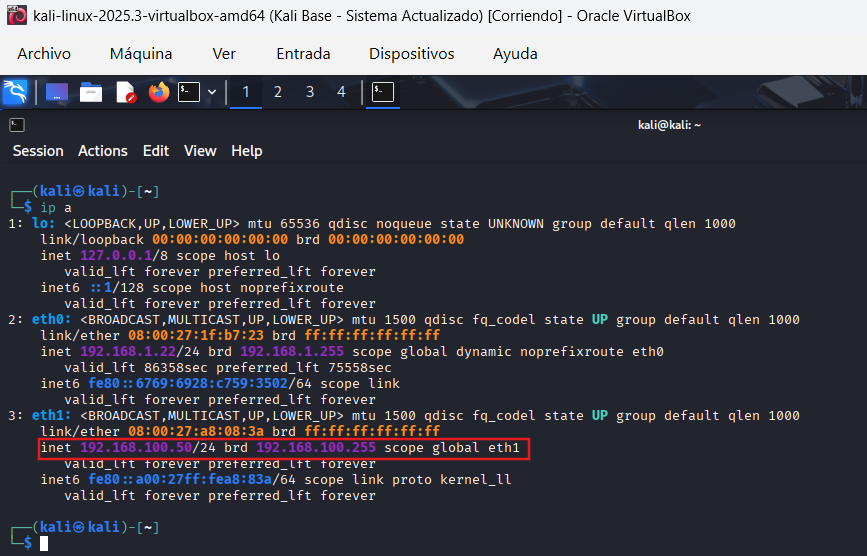
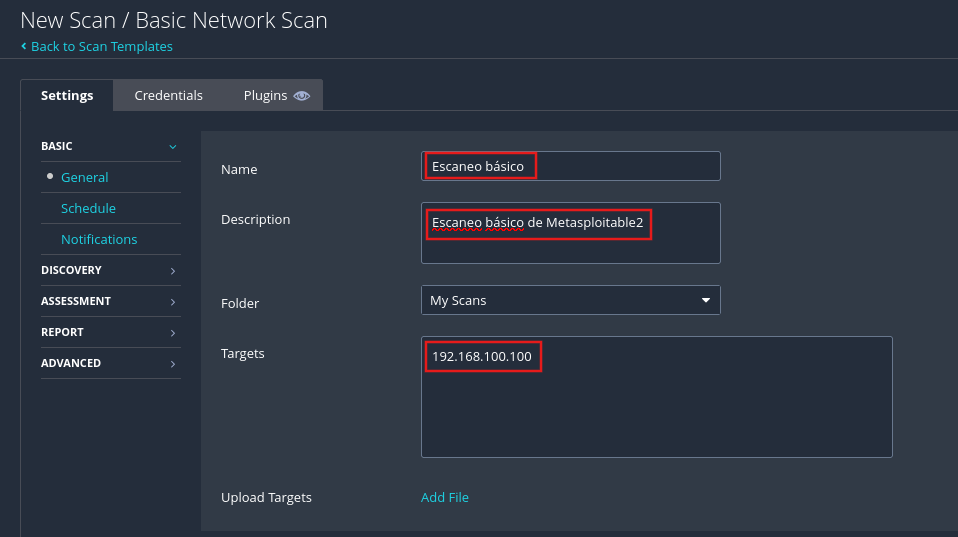
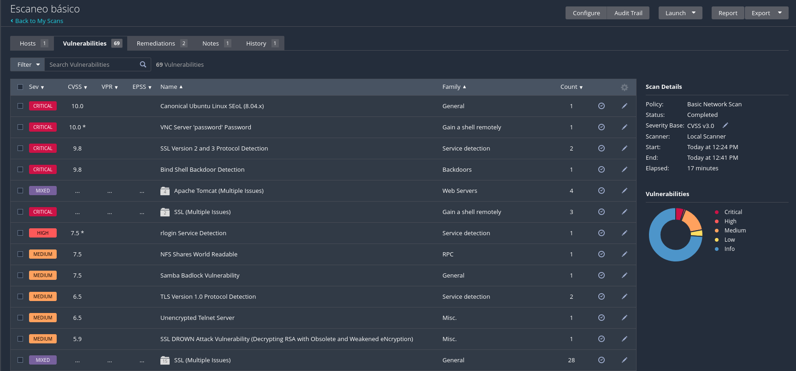
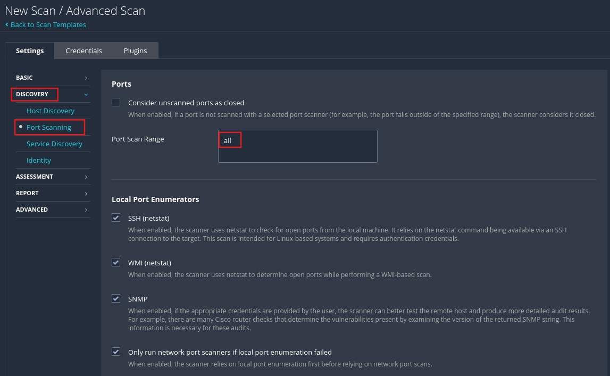
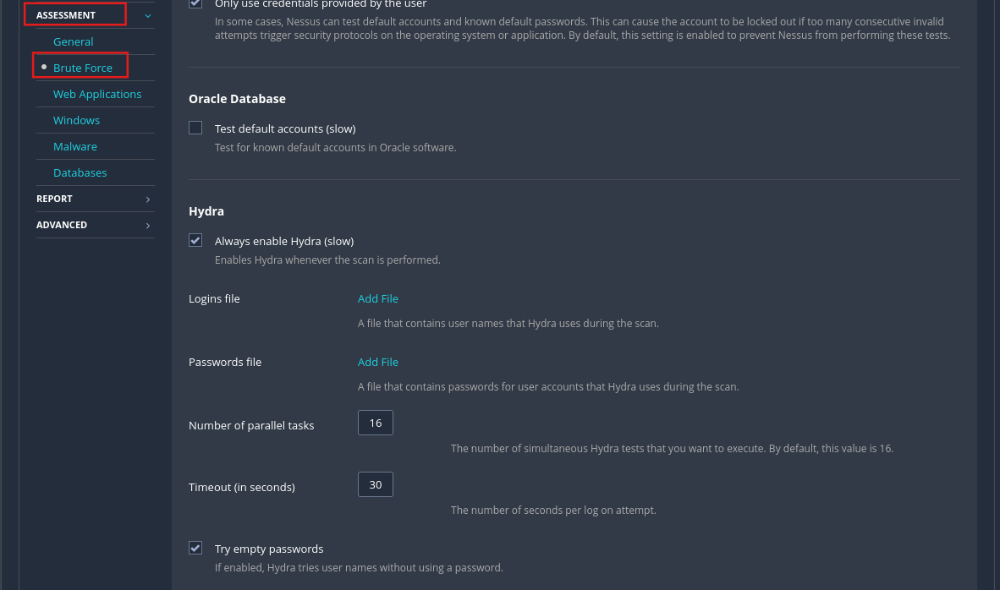
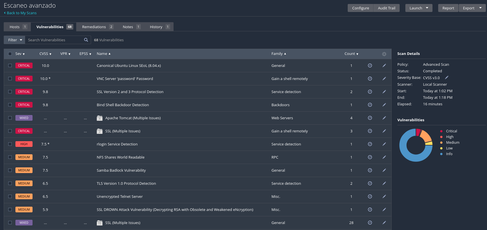

# Nessus Vulnerability Assessment — Metasploitable2 Lab

## Overview

This project documents a vulnerability assessment performed with Nessus Essentials against a Metasploitable2 virtual machine in a controlled and isolated laboratory environment.

The assessment included basic and advanced vulnerability scans, severity-based analysis, prioritization of security findings, and remediation recommendations.

The objective was to identify exposed services, insecure configurations, outdated protocols, and known vulnerabilities, while comparing the visibility provided by different Nessus scan configurations.

## Scope

The assessment was performed against a Metasploitable2 virtual machine deployed in an isolated laboratory environment.

The objective was to evaluate the target's attack surface using Nessus Essentials and compare the results obtained from basic and advanced vulnerability scans.

The assessment focused on:

- Detecting exposed services and open ports
- Identifying known vulnerabilities and insecure configurations
- Classifying findings by severity
- Prioritizing vulnerabilities based on technical impact
- Comparing basic and advanced scan coverage
- Documenting remediation and mitigation recommendations

All testing was performed in a controlled environment created specifically for cybersecurity training.

## Lab Environment

The vulnerability assessment was performed in a controlled virtual laboratory using Oracle VirtualBox.

The environment consisted of two virtual machines:

| Machine | Role | IP Address | Network Configuration |
|---|---|---|---|
| Kali Linux | Security assessment workstation running Nessus Essentials | `192.168.100.50` | Host-Only + Bridged Adapter |
| Metasploitable2 | Vulnerable target system | `192.168.100.100` | Host-Only |

The **Host-Only network** was used to isolate vulnerability scanning traffic between Kali Linux and Metasploitable2.

The **Bridged Adapter** on Kali Linux provided Internet connectivity for Nessus plugin updates, product registration, and system updates.

This architecture allowed vulnerability scanning to be performed in an isolated environment without affecting external systems.

  
  

*Network configuration of the isolated lab environment, showing the Metasploitable2 target at `192.168.100.100` and the Kali Linux assessment workstation with its Host-Only interface at `192.168.100.50`.*

## Methodology

The vulnerability assessment followed a structured process using Nessus Essentials within the isolated lab environment.

The methodology consisted of the following stages:

1. **Lab preparation**
   - Kali Linux was used as the assessment workstation.
   - Metasploitable2 was used as the vulnerable target.
   - Host-Only networking was used to isolate scanning traffic.

2. **Basic vulnerability scan**
   - A Basic Network Scan was configured against the Metasploitable2 target.
   - Nessus was used to identify exposed services, open ports, insecure configurations, and known vulnerabilities.

3. **Advanced vulnerability scan**
   - An Advanced Scan was configured to increase scan coverage.
   - The configuration included full port scanning and additional host discovery techniques.
   - Credential testing options were also enabled to identify weak or default credentials.

4. **Finding analysis and prioritization**
   - Detected vulnerabilities were reviewed by severity and technical impact.
   - Higher-risk findings were prioritized based on exploitability, exposed services, and potential impact on confidentiality, integrity, and availability.

5. **Mitigation review**
   - Remediation recommendations were documented for prioritized findings.
   - The recommendations focused on reducing attack surface, removing insecure services, strengthening authentication, and updating obsolete protocols or vulnerable components.

6. **Scan comparison**
   - Results from the basic and advanced scans were compared to evaluate differences in visibility and depth of detection.

## Basic Vulnerability Scan

A Basic Network Scan was configured in Nessus Essentials against the Metasploitable2 target at `192.168.100.100`.

  

*Basic Network Scan configuration in Nessus Essentials targeting the Metasploitable2 host at `192.168.100.100`.*

The purpose of the initial scan was to establish a baseline of the target's exposed attack surface by identifying:

- Open ports and exposed network services
- Known vulnerabilities associated with detected services
- Insecure configurations
- Outdated or vulnerable software components
- Findings classified by severity

The scan produced findings across multiple severity levels, including Critical, High, Medium, Low, and Informational.

  

*Basic Nessus scan results showing prioritized findings across multiple severity levels, including critical remote-access, backdoor, insecure protocol, and exposed-service issues.*

This initial assessment provided a broad overview of the target's security posture and served as the baseline for comparison with the later advanced scan.

## Advanced Vulnerability Scan

To complement the initial assessment, an Advanced Scan was configured in Nessus Essentials against the same Metasploitable2 target.

The advanced configuration was used to increase scan depth and broaden coverage beyond the default Basic Network Scan.

The following options were enabled:

- **Full port scanning** to analyze the complete port range and identify services running on non-standard ports

  

*Advanced Scan configuration in Nessus Essentials with the port scan range set to `all`, expanding coverage across the full TCP/UDP port range.*

- **Multiple host discovery techniques**, including TCP ping, UDP ping, and ARP scan
- **Credential testing options** to identify weak, default, or empty credentials on exposed services

  

*Advanced Scan credential-testing configuration showing Hydra-based brute-force checks and empty-password testing against exposed services.*

The advanced scan identified a vulnerability profile broadly similar to the basic scan, while providing deeper visibility into selected services and producing additional informational findings.

  

*Advanced Nessus scan results showing the vulnerability profile identified after expanding scan coverage and enabling additional assessment options.*

## Findings & Prioritization

The vulnerability assessment identified findings across multiple severity levels.

Rather than relying only on the number of detected issues, the analysis focused on prioritizing vulnerabilities based on technical impact, exploitability, exposed services, and the potential effect on confidentiality, integrity, and availability.

### Prioritized Findings

| Finding | Severity | Impact | Prioritization Rationale |
|---|---|---|---|
| VNC Server "password" Password | Critical (CVSS 10.0) | Remote desktop access protected by a weak/default password, potentially leading to full system compromise | Immediately exploitable remote access with direct impact on confidentiality, integrity, and availability |
| Bind Shell Backdoor Detection | Critical (CVSS 9.8) | Indicates the presence of a backdoor capable of remote command execution | Allows an attacker to execute arbitrary commands and take control of the system |
| SSL Version 2 and 3 Protocol Detection | Critical (CVSS 9.8) | Use of obsolete cryptographic protocols vulnerable to known attacks | Exposes encrypted traffic and credentials to interception or downgrade attacks |
| Unencrypted Telnet Server | Medium (CVSS 6.5) | Credentials and commands are transmitted in plaintext | Enables credential interception and increases the risk of unauthorized access |
| NFS Shares World Readable | Medium (CVSS 7.5) | Shared resources can be accessed without proper authentication | May expose sensitive information and assist reconnaissance or lateral movement |

The prioritized findings shared a common characteristic: they significantly increased the target's attack surface and could enable compromise with limited attacker interaction.

The analysis therefore emphasized vulnerabilities that exposed remote access, weak authentication, insecure protocols, backdoors, or unnecessarily accessible services.

## Mitigation Recommendations

Based on the prioritized findings, the following mitigation measures were recommended:

- **Disable unnecessary remote services** such as Telnet and VNC when they are not operationally required.
- **Replace insecure services with encrypted alternatives**, such as SSH instead of Telnet and secure remote-access protocols where remote administration is necessary.
- **Remove or disable obsolete cryptographic protocols**, including SSLv2, SSLv3, and legacy TLS versions.
- **Review exposed services for insecure or backdoored configurations** and remove unnecessary attack surface.
- **Restrict NFS shares and other shared resources** so they are not globally accessible without appropriate authentication.
- **Apply strong authentication controls** to reduce the risk of unauthorized access.
- **Segment the network** to limit lateral movement and reduce the impact of a successful compromise.
- **Patch, update, or reconfigure vulnerable services** such as Apache Tomcat and Samba to address known weaknesses and insecure configurations.
- **Perform a follow-up vulnerability scan after remediation** to verify that identified findings have been successfully resolved or reduced.

These measures were intended to reduce exposed attack surface, strengthen access controls, remove insecure protocols, and improve the overall security posture of the target system.

## Basic vs Advanced Scan Comparison

The Basic Network Scan and Advanced Scan identified a broadly similar vulnerability profile on the Metasploitable2 target.

However, the advanced configuration provided greater depth by expanding port coverage, applying additional host discovery techniques, and enabling credential-testing options.

### Comparison Summary

| Area | Basic Scan | Advanced Scan |
|---|---|---|
| Scan configuration | Basic Network Scan | Advanced Scan with customized settings |
| Port coverage | Standard scan configuration | Full port range |
| Host discovery | Standard scan configuration | TCP ping, UDP ping, and ARP scan enabled |
| Credential testing | Not specifically configured in the documented basic scan | Credential-testing options enabled |
| Detection depth | Initial vulnerability baseline | Broader configured scan coverage |
| Informational findings | Lower | Higher |
| Primary value | Establishing the initial security baseline | Increasing scan depth and contextual visibility |

The comparison showed that a basic vulnerability scan can provide an effective initial overview of exposed risk, while a more extensively configured scan can improve visibility into services, configurations, and additional informational findings.

This comparison highlighted how scan configuration can influence vulnerability visibility and detection depth. The advanced scan produced additional informational findings and provided deeper coverage of selected services.

## Conclusion

The Nessus assessment successfully identified a range of critical, high, medium, low, and informational findings across the Metasploitable2 target.

The comparison between the Basic Network Scan and the Advanced Scan showed that deeper scan configuration can improve visibility into exposed services and provide additional context for vulnerability analysis.

The exercise reinforced the importance of combining automated vulnerability scanning with manual review, prioritization, and remediation planning in order to reduce attack surface and improve the overall security posture of a system.

## Lessons Learned

This project reinforced several important vulnerability-management principles:

- Vulnerability scanning is most useful when findings are manually reviewed and prioritized rather than accepted at face value.
- Severity scores alone are not sufficient; exploitability, exposed services, and technical impact must also be considered.
- Scan configuration directly affects the depth and visibility of detected vulnerabilities.
- Insecure legacy services and protocols can significantly increase attack surface.
- Effective remediation should focus on reducing unnecessary exposure, strengthening authentication, patching vulnerable services, and disabling obsolete protocols.
- Follow-up scanning is important to verify that remediation actions have actually reduced or removed identified risk.

