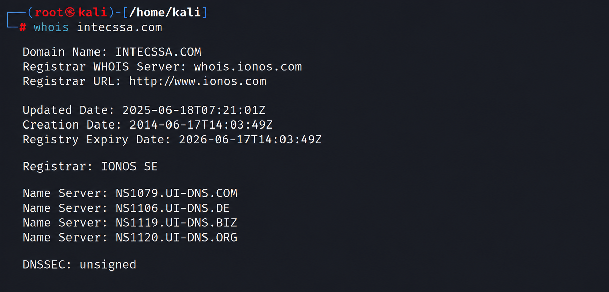
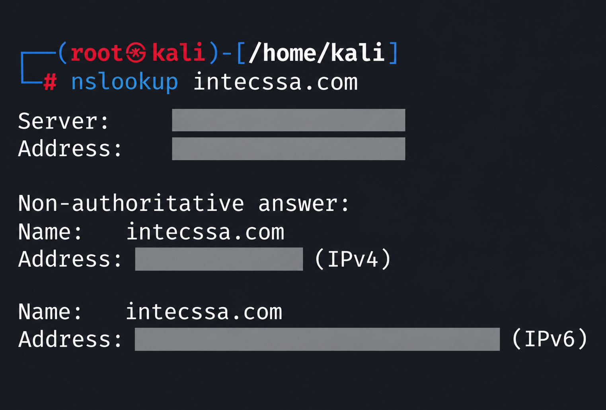
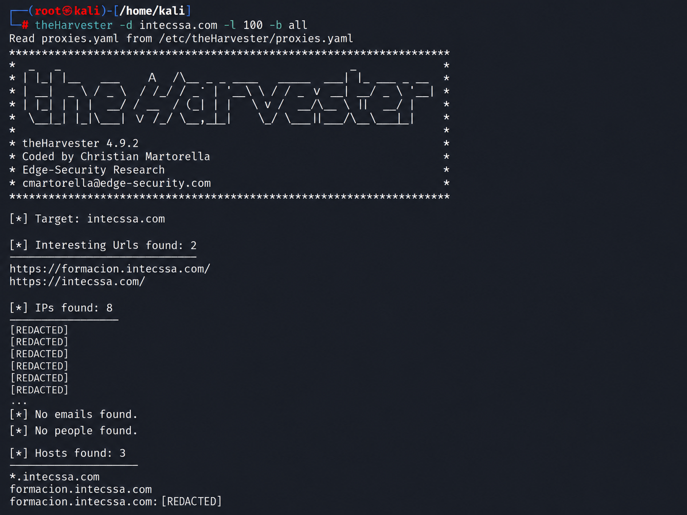
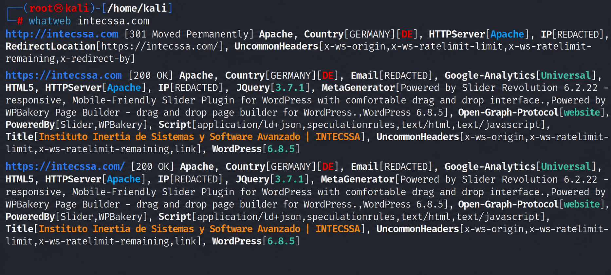
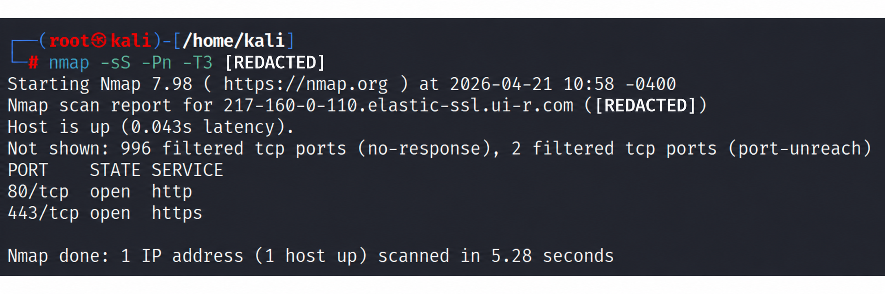

# Web Security Assessment Lab

## Overview

This project documents an authorized, non-intrusive web security assessment performed against INTECSSA as part of a final cybersecurity training project.

The assessment focused on reconnaissance, service enumeration, technology fingerprinting, HTTP security headers, public asset exposure, and risk analysis.

No denial-of-service testing, destructive exploitation, or intrusive attacks were performed.

## Scope

The assessment was limited to publicly accessible assets associated with INTECSSA's web environment.

The scope included:

- Passive reconnaissance
- DNS and domain analysis
- Subdomain discovery
- Service enumeration
- Technology fingerprinting
- HTTP security header analysis
- Manual validation of automated findings

Out of scope:

- Denial-of-service testing
- Destructive exploitation
- Credential attacks
- Privilege escalation
- Any activity that could affect service availability

For portfolio purposes, specific IP addresses, email addresses, subdomains, and other infrastructure details have been redacted or anonymized.

## Methodology

The assessment followed a structured, non-intrusive methodology based on common penetration testing phases.

### 1. Passive Reconnaissance
Publicly available information related to the target was collected in order to identify domain registration data, DNS information, exposed assets, and publicly visible infrastructure.

### 2. Asset Discovery and Enumeration
Discovered assets were reviewed to identify publicly exposed services, subdomains, and network-facing components.

### 3. Technology Fingerprinting
Web technologies, server software, CMS components, and publicly exposed metadata were identified to better understand the target's attack surface.

### 4. Web Security Configuration Review
The exposed web services were analyzed for security configuration weaknesses, including missing HTTP security headers and other potentially risky configurations.

### 5. Manual Validation
Automated findings were manually validated using direct HTTP requests and service inspection in order to reduce false positives and confirm the accuracy of the results.

### Tools Used

- WHOIS
- nslookup
- theHarvester
- WhatWeb
- Nmap
- Nikto
- curl

## Reconnaissance

### Domain Registration & DNS Context

Initial reconnaissance was performed using WHOIS queries to gather publicly available information about the target domain, including registration details, DNS infrastructure, and hosting information.

The results confirmed that the domain was active and provided useful context for the subsequent enumeration phases.

  

*WHOIS enumeration used to verify public registration and DNS information associated with the target domain.*

> Some infrastructure details have been redacted or anonymized for portfolio purposes.

### DNS Resolution

DNS resolution was analyzed using `nslookup` to identify the IPv4 and IPv6 addresses associated with the target.

This information was used to correlate the web-facing infrastructure with later service enumeration and technology fingerprinting results.

  

*DNS resolution used to identify the target's public IPv4 and IPv6 infrastructure.*

### Asset and Subdomain Discovery

`theHarvester` was used to identify publicly exposed assets related to the target.

The analysis revealed an additional subdomain associated with the organization, expanding the scope of the publicly visible attack surface.

No publicly exposed users or employee email addresses were identified during this phase.

  

*theHarvester was used to identify publicly exposed subdomains and related infrastructure associated with the target.*

### Public Exposure Analysis

Search-engine-based reconnaissance was performed to identify potentially exposed documents, administrative interfaces, or other indexed resources.

No sensitive documents, administrative panels, or critical information were identified through these searches.

## Analysis & Findings

The information gathered during reconnaissance was used to perform a focused analysis of the publicly exposed web infrastructure.

The assessment identified several configuration weaknesses and information disclosure issues. Each finding was reviewed manually and evaluated according to its potential impact on the target environment.

---

### Finding 1 — Technology and System Information Disclosure

**Severity:** Medium

#### Description

Technology fingerprinting identified several components used by the target web environment, including:

- Apache web server
- WordPress CMS
- WPBakery Page Builder
- Slider Revolution
- jQuery

Additional information was also exposed through HTTP headers and publicly accessible metadata.

While technology disclosure is not necessarily a vulnerability by itself, detailed information about software, versions, and components can help an attacker identify relevant attack vectors or known vulnerabilities.

  

*WhatWeb fingerprinting identified the target's web stack, including Apache, WordPress, jQuery, WPBakery, Slider Revolution, and additional HTTP metadata. Public IP and email information were redacted for portfolio purposes.*

#### Impact

Exposing detailed information about the technology stack may facilitate further reconnaissance by allowing an attacker to:

- Identify potentially vulnerable software versions
- Search for known vulnerabilities affecting installed components
- Profile the target environment more accurately
- Prepare more targeted attacks

#### Recommendation

- Minimize unnecessary technology and version disclosure
- Keep WordPress, plugins, themes, and server components updated
- Review HTTP headers and metadata for unnecessary information exposure
- Apply secure configuration practices to reduce fingerprinting opportunities

### Finding 2 — Exposed Web Services

**Severity:** Low

#### Description

Service enumeration performed with `Nmap` identified only two publicly exposed TCP services:

- **80/tcp — HTTP**
- **443/tcp — HTTPS**

The remaining scanned ports were filtered, indicating that network-level access controls are limiting unnecessary exposure.

An inconsistency was also observed in the web server identification results. While `Nmap` identified the exposed service as `nginx`, other tools such as WhatWeb and manual HTTP header validation indicated the presence of Apache.

This behavior may suggest the use of a reverse proxy, load balancer, or layered web architecture in which different components are visible depending on the point of observation.

  

*`Nmap` service enumeration confirmed that only HTTP (80/tcp) and HTTPS (443/tcp) were publicly exposed. The target IP address was redacted for portfolio purposes.*

#### Impact

The exposure of HTTP and HTTPS is expected for a public web service and does not represent a vulnerability by itself.

However, publicly accessible web services remain part of the attack surface and should be carefully maintained and monitored.

The discrepancy between identified server technologies may also indicate the presence of multiple infrastructure layers, which should be properly documented and securely configured.

#### Recommendation

- Keep only strictly necessary services exposed to the Internet
- Maintain firewall rules that restrict access to non-public services
- Ensure exposed web services remain updated and securely configured
- Review the web architecture to confirm whether reverse proxy or load balancing components are in use
- Maintain accurate documentation of externally exposed infrastructure

### Finding 3 — Subdomain Misconfiguration and External Infrastructure

**Severity:** Medium

#### Description

During the analysis of an identified subdomain, the associated service was found to point to infrastructure different from the organization's primary web environment.

Service enumeration identified:

- Nginx web server
- AlmaLinux operating system
- An SSL/TLS certificate whose Common Name referenced an unrelated external domain
- HTTP redirection toward external infrastructure

This inconsistency indicates that the subdomain may be pointing to shared, outdated, or incorrectly managed infrastructure.

For portfolio purposes, the specific subdomain, IP address, and external domain have been anonymized.

#### Impact

Incorrect or inconsistent subdomain configuration can introduce several risks, including:

- Exposure of services not directly managed by the organization
- Loss of visibility over externally hosted infrastructure
- Increased dependency on third-party systems
- Certificate validation and trust issues
- Potential asset-management gaps
- Confusion during incident response or security monitoring

Although no direct exploitation was performed, the configuration inconsistency increases the complexity of the organization's external attack surface.

#### Recommendation

- Review DNS records associated with the affected subdomain
- Confirm that the subdomain points only to authorized infrastructure
- Verify SSL/TLS certificate configuration and domain ownership
- Remove obsolete or unused DNS records
- Maintain a centralized inventory of public domains, subdomains, certificates, and external dependencies
- Periodically review externally hosted assets for configuration drift

### Finding 4 — Missing HTTP Security Headers

**Severity:** Medium

#### Description

Automated web security analysis identified several missing HTTP security headers in the target application.

The following protections were not present in the server responses:

- `X-Frame-Options`
- `Strict-Transport-Security`
- `X-Content-Type-Options`

The findings were later manually validated using `curl`, confirming that the headers were not present in the HTTP response.

This manual verification helped reduce the possibility of relying exclusively on automated scanner output.

#### Impact

Missing HTTP security headers can weaken the browser-side security posture of a web application.

Potential risks include:

- Increased exposure to clickjacking attacks
- Lack of enforced HTTPS through HSTS
- MIME-type interpretation issues when `X-Content-Type-Options` is not configured
- Reduced defense-in-depth against common web-based attack techniques

These issues do not necessarily represent a critical vulnerability on their own, but they indicate that the web server could benefit from additional security hardening.

#### Recommendation

- Implement `X-Frame-Options` or an equivalent `Content-Security-Policy` frame restriction
- Configure `Strict-Transport-Security` to enforce HTTPS connections
- Add `X-Content-Type-Options: nosniff`
- Review the overall HTTP security header configuration against current web security best practices
- Periodically validate headers manually in addition to using automated security scanners

## Risk Summary

The assessment did not identify any critical vulnerabilities within the defined non-intrusive scope.

However, several security weaknesses and configuration issues were identified across the public-facing web environment.

| Finding | Severity |
|---|---|
| Technology and System Information Disclosure | Medium |
| Exposed Web Services | Low |
| Subdomain Misconfiguration and External Infrastructure | Medium |
| Missing HTTP Security Headers | Medium |

Overall, the environment presents a **moderate level of exposure**, primarily related to web-facing services, infrastructure consistency, and security hardening.

The most relevant areas for improvement are:

- Reducing unnecessary technology and version disclosure
- Maintaining accurate control over subdomains and external infrastructure
- Strengthening HTTP security headers
- Continuing to limit publicly exposed services to only those strictly required

No evidence of a critical compromise path was identified within the authorized scope of the assessment.

## Conclusion

This assessment provided a structured review of INTECSSA's publicly exposed web environment using non-intrusive reconnaissance, service enumeration, technology fingerprinting, and configuration analysis.

The assessment confirmed that the external attack surface was relatively limited, with only the necessary web services exposed. However, several areas for improvement were identified, including information disclosure, inconsistent subdomain and certificate configuration, and missing HTTP security headers.

No critical vulnerabilities were identified within the authorized scope.

The overall security posture was assessed as **moderate**, with the main recommendations focused on improving infrastructure visibility, strengthening web security configuration, and maintaining consistent management of public-facing assets.

---

## Lessons Learned

This project reinforced several key aspects of a structured security assessment:

- The importance of defining a clear scope before beginning any technical testing
- How passive and active reconnaissance can be combined to build an accurate picture of the target environment
- The value of correlating results from multiple tools instead of relying on a single source
- The importance of manually validating automated findings to reduce false positives
- How infrastructure inconsistencies, such as mismatched server fingerprints or certificate information, can reveal additional attack-surface context
- The importance of documenting not only vulnerabilities, but also impact, severity, and remediation

The project also highlighted that a useful security assessment does not always require exploitation. Careful reconnaissance, validation, and configuration review can identify meaningful security improvements without disrupting the target environment.

