# Windows Detection & Monitoring Lab — Sysmon, Wazuh & MITRE ATT&CK


## Overview

This project documents the deployment and use of a Windows detection and monitoring lab built with Sysmon, Wazuh, and MITRE ATT&CK.

The lab was designed to collect Windows endpoint telemetry, centralize events in Wazuh, generate controlled security-relevant activity, and analyze how that activity is represented across Sysmon, Windows Security logs, and Wazuh.

The environment includes a Windows 10 monitored endpoint, a Wazuh server hosted on Ubuntu, and a Kali Linux machine used to generate controlled network activity.


## Objectives

- Deploy a centralized Wazuh monitoring environment.
- Install and configure the Wazuh agent on a Windows 10 endpoint.
- Collect detailed endpoint telemetry using Sysmon.
- Ingest Sysmon and Windows Security events into Wazuh.
- Generate controlled security-relevant activity in an isolated lab environment.
- Analyze process creation, account activity, authentication failures, and network connections.
- Map relevant activity to MITRE ATT&CK techniques where appropriate.
- Document evidence, observations, and security implications for each detection scenario.


## Lab Architecture

The lab was built in VirtualBox using three isolated virtual machines connected through an internal network named `CYBER-LAB`.

| System | Role | IP Address | Main Components |
|---|---|---:|---|
| Ubuntu Server | Central monitoring platform | `10.10.10.10` | Wazuh Manager, Wazuh Indexer, Wazuh Dashboard, Filebeat |
| Windows 10 | Monitored endpoint | `10.10.10.20` | Wazuh Agent, Sysmon, Windows Security Logs |
| Kali Linux | Controlled testing machine | `10.10.10.30` | Nmap and network testing tools |


### Network Design

The systems communicate through the isolated `10.10.10.0/24` lab network.


```text
                    CYBER-LAB
                  10.10.10.0/24

             +---------------------+
             |    Ubuntu / Wazuh   |
             |     10.10.10.10     |
             |                     |
             | Wazuh Manager       |
             | Wazuh Indexer       |
             | Wazuh Dashboard     |
             +----------+----------+
                        |
              +---------+---------+
              |                   |
     +--------+---------+   +-----+----------+
     |    Windows 10    |   |   Kali Linux   |
     |   10.10.10.20    |   |  10.10.10.30  |
     |                  |   |                |
     | Wazuh Agent      |   | Controlled     |
     | Sysmon           |   | test activity  |
     +------------------+   +----------------+
```


The Windows endpoint forwards Windows Security and Sysmon telemetry to the Wazuh server for centralized analysis.

Kali Linux is used only to generate controlled network activity inside the isolated lab environment.


---


## Tools & Technologies

- **Wazuh** — Centralized security monitoring, event collection, alerting, and threat hunting.
- **Sysmon** — Enhanced Windows endpoint telemetry for process creation, network connections, DNS activity, and other security-relevant events.
- **Windows Event Viewer** — Native inspection of Windows Security and Sysmon logs.
- **Kali Linux** — Controlled testing system used to generate network activity inside the lab.
- **Nmap** — Network service discovery and port scanning.
- **VirtualBox** — Virtualization platform used to host the isolated lab environment.
- **MITRE ATT&CK** — Framework used to map observed behavior to relevant adversary tactics and techniques.


---


## Environment Setup & Monitoring Pipeline

The monitoring workflow was designed to centralize endpoint telemetry from the Windows 10 system into Wazuh for analysis.

The Windows endpoint generates security-relevant telemetry through two main sources:

- **Windows Security Logs** — Authentication events, account management activity, and local group modifications.
- **Sysmon** — Detailed process creation and network connection telemetry.

The Wazuh Agent installed on the Windows endpoint forwards these events to the Wazuh server.

The resulting monitoring pipeline is:

`Windows Activity → Windows Security / Sysmon → Wazuh Agent → Wazuh Manager → Wazuh Indexer → Wazuh Dashboard`


### Sysmon Configuration

Sysmon was configured to collect the telemetry required for this lab while avoiding unnecessary event volume.

The main monitored event types were:

- **Event ID 1** — Process Creation
- **Event ID 3** — Network Connection
- **DNS Query telemetry**


### Wazuh Event Collection

The Wazuh Agent was configured to collect events from the Sysmon Operational channel:

`Microsoft-Windows-Sysmon/Operational`

Raw event archiving was also enabled in Wazuh.

This allowed the lab to analyze both:

- `wazuh-alerts-*` — Events that triggered Wazuh detection rules.
- `wazuh-archives-*` — Raw events ingested by Wazuh, including events that did not generate an alert.

This distinction was important during the lab because some controlled activities produced useful telemetry without triggering a dedicated Wazuh alert.


---


## Detection Scenarios

### 1. PowerShell Execution


#### Activity

PowerShell was executed on the monitored Windows 10 endpoint to generate process creation telemetry.

The following commands were used:

```powershell
Get-LocalUser
Get-Process | Select-Object -First 5
Write-Output "CYBER-LAB-POWERSHELL-TEST"
```


#### Sysmon Evidence

Sysmon recorded the PowerShell execution as a **Process Create** event.

Relevant details included:

- **Event ID:** `1`
- **Image:** `C:\Windows\System32\WindowsPowerShell\v1.0\powershell.exe`
- **Event Type:** Process Creation

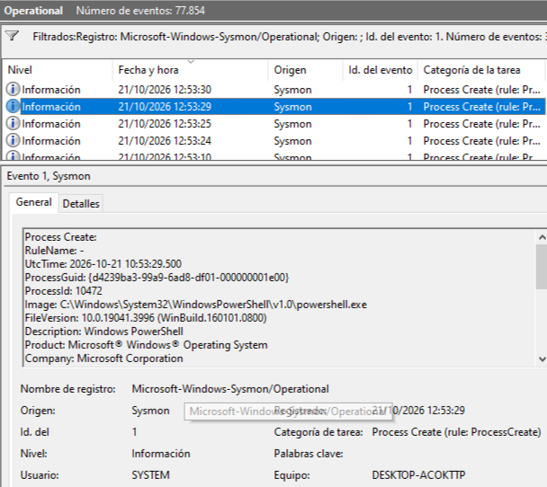


#### Wazuh Evidence

The Sysmon event was successfully ingested by Wazuh and was visible in the `wazuh-archives-*` index.

The event included information such as:

- PowerShell executable path
- Process metadata
- Parent process information
- SHA256 hash
- Original file name

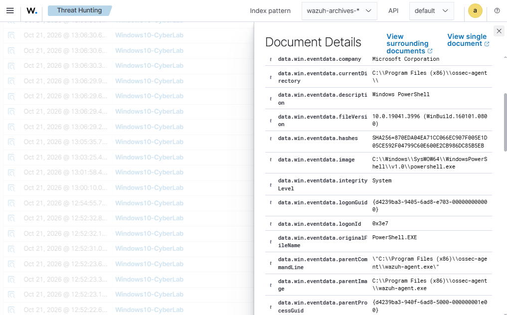


#### MITRE ATT&CK Mapping

- **Tactic:** Execution
- **Technique:** `T1059` — Command and Scripting Interpreter
- **Sub-technique:** `T1059.001` — PowerShell


#### Observation

The activity demonstrated how PowerShell execution can be observed through endpoint process creation telemetry.

Sysmon Event ID `1` captured the execution of `powershell.exe`, while Wazuh successfully ingested the event for centralized analysis.

The commands used during this test were benign and did not trigger a dedicated Wazuh alert.

Although PowerShell is commonly associated with `T1059.001 — PowerShell`, its execution alone does not indicate malicious activity. Additional context such as command-line arguments, parent processes, encoded commands, network activity, or surrounding events would be required to determine whether the activity is suspicious.

This scenario therefore demonstrates telemetry collection and ATT&CK behavioral mapping rather than detection of malicious PowerShell activity.


---


### 2. Local Account Discovery


#### Activity

Local account enumeration was performed on the monitored Windows 10 endpoint to observe how account discovery activity is recorded by Sysmon and Wazuh.

The following commands were used:

```powershell
Get-LocalUser
net user
```


#### Sysmon Evidence

Sysmon recorded the account discovery activity as a **Process Create** event.

Relevant details included:

- **Event ID:** `1`
- **Original File Name:** `net.exe`
- **Command Line:** `C:\Windows\System32\net.exe user`
- **Event Type:** Process Creation

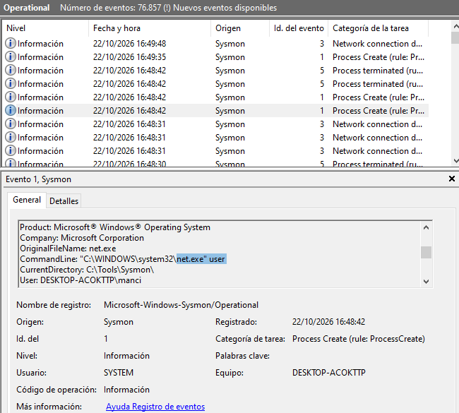


#### Wazuh Evidence

The event was successfully ingested by Wazuh and was visible in the `wazuh-archives-*` index.

The collected telemetry showed the execution of the Windows `net` utility used to enumerate local accounts.

Relevant fields included:

- Agent: `Windows10-CyberLab`
- Process: `net1.exe`
- Command Line: `C:\Windows\System32\net1 user`
- Description: `Net Command`

Windows may invoke `net1.exe` internally when processing commands executed through the `net` utility, which explains the process name observed in the Wazuh telemetry.

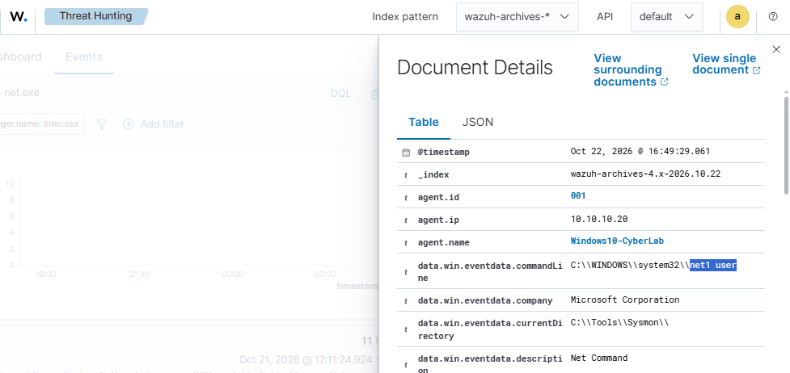


#### MITRE ATT&CK Mapping

- **Tactic:** Discovery
- **Technique:** `T1087` — Account Discovery
- **Sub-technique:** `T1087.001` — Local Account


#### Observation

The activity demonstrated how native Windows account enumeration can be identified through process creation telemetry.

Sysmon Event ID `1` captured the execution of the Windows `net` utility and its associated command line, while Wazuh centralized the event for investigation.

Although `net user` is a legitimate administrative command, the same behavior can be used during post-compromise discovery to identify local accounts available on a system.

The security relevance of the event therefore depends on additional context such as the executing user, parent process, command line, timing, and surrounding activity.


---


### 3. Local User Creation


#### Activity

A new local user account named `LabUser` was created on the monitored Windows 10 endpoint to observe how account creation activity is recorded across Sysmon, Windows Security logs, and Wazuh.

The following command was used:

```cmd
net user LabUser [LAB-PASSWORD] /add
```

The account was then verified with:

```cmd
net user LabUser
```


#### Sysmon Evidence

Sysmon recorded the account creation activity as a **Process Create** event.

Relevant details included:

- **Event ID:** `1`
- **Process:** `net1.exe`
- **Command Line:** `C:\Windows\System32\net1 user LabUser [LAB-PASSWORD] /add`

Windows internally invoked `net1.exe` while processing the `net user` command executed during the test.

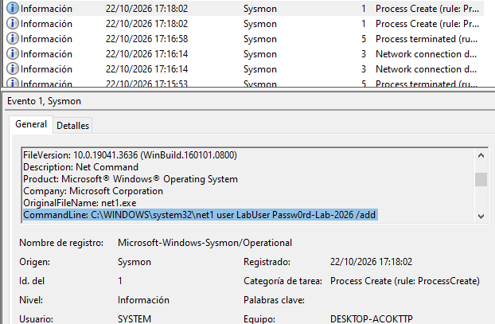


#### Windows Security Evidence

Windows Security generated **Event ID 4720**, indicating that a new user account was created.

Relevant details included:

- **Event ID:** `4720`
- **Account Name:** `LabUser`
- **Category:** User Account Management

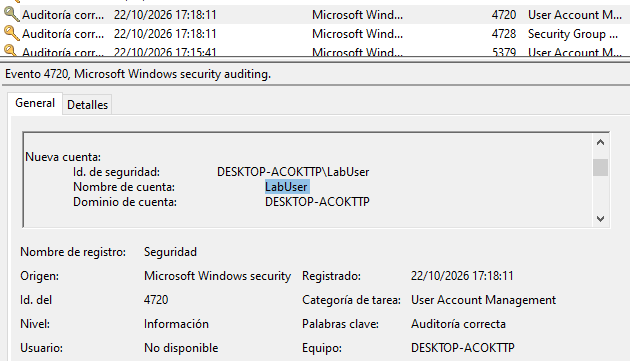


#### Wazuh Evidence

The account creation activity was also ingested by Wazuh and was visible in the `wazuh-archives-*` index.

Relevant fields included:

- Agent: `Windows10-CyberLab`
- Process: `net1.exe`
- Command Line: `C:\Windows\System32\net1 user LabUser Passw0rd-Lab-2026 /add`
- Description: `Net Command`

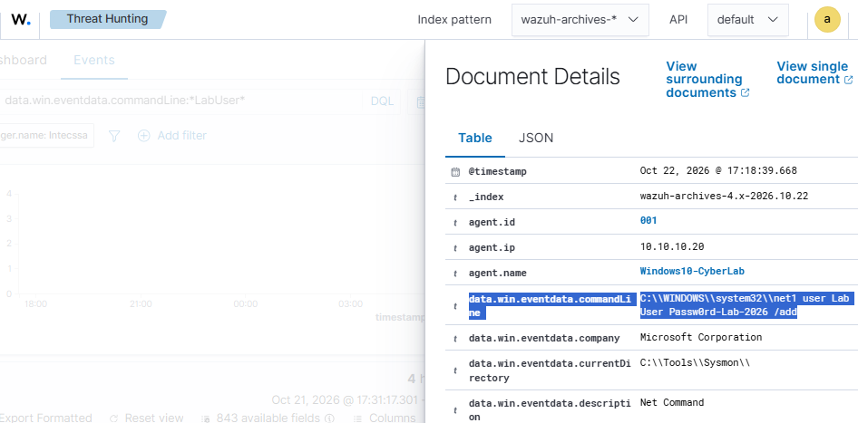


#### MITRE ATT&CK Mapping

- **Tactic:** Persistence
- **Technique:** `T1136` — Create Account
- **Sub-technique:** `T1136.001` — Local Account


#### Observation

This scenario demonstrated how local account creation can be observed through multiple telemetry sources.

Sysmon provided process-level visibility into the command used to create the account, Windows Security recorded the account creation event itself, and Wazuh centralized the telemetry for investigation.

This type of activity is especially relevant because unauthorized local account creation can be used to establish persistence on a compromised Windows system.


---


### 4. Failed Logon Attempts


#### Activity

Several failed logon attempts were generated against the local `LabUser` account on the monitored Windows 10 endpoint.

The objective was to observe how Windows records authentication failures and how those events are ingested by Wazuh for centralized analysis.


#### Windows Security Evidence

Windows Security generated **Event ID 4625**, which represents a failed account logon.

Relevant details included:

- **Event ID:** `4625`
- **Target User:** `LabUser`
- **Logon Type:** `2` — Interactive logon
- **Status:** `0xc000006d`
- **SubStatus:** `0xc000006a`

The `0xc000006a` substatus indicates that the authentication attempt failed because an incorrect password was provided.

Multiple consecutive failed logon events were recorded during the test.

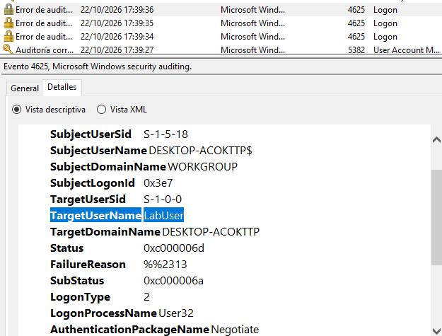


#### Wazuh Evidence

The failed authentication events were successfully ingested by Wazuh and were visible in the `wazuh-archives-*` index.

Relevant fields included:

- Agent: `Windows10-CyberLab`
- Target User: `LabUser`
- Logon Type: `2`
- Status: `0xc000006d`
- SubStatus: `0xc000006a`
- Authentication Package: `Negotiate`

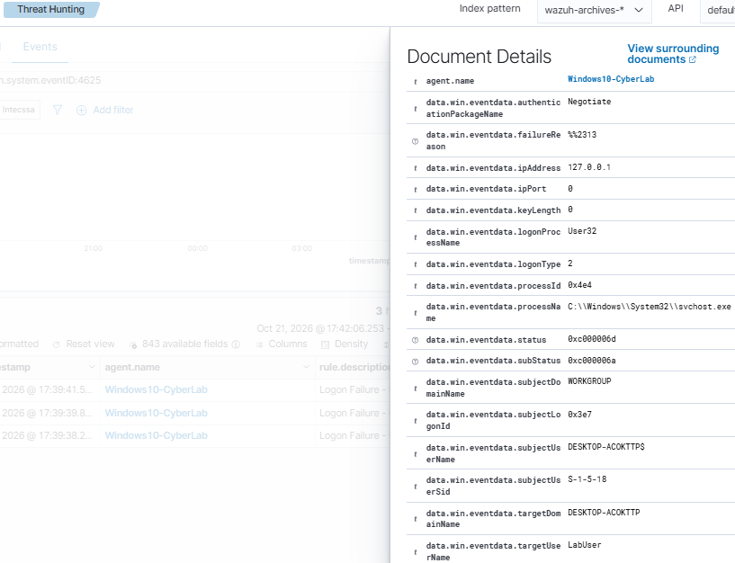


#### Observation

This scenario demonstrated how failed authentication attempts can be identified through native Windows Security logging and centralized in Wazuh.

Event ID `4625` provides useful context for authentication monitoring, including the affected account, logon type, and failure reason.

Because this test consisted of only a small number of manually generated failed logons, it is documented as authentication failure monitoring rather than being classified as a brute-force attack.

In a production environment, repeated failed authentication events could be correlated with additional indicators to identify suspicious login behavior or password-guessing activity.


---


### 5. Network Service Discovery


#### Activity

A controlled network scan was performed from the Kali Linux system against the monitored Windows 10 endpoint.

The following Nmap command was used:

```bash
nmap -sS -sV 10.10.10.20
```

The scan identified several exposed services on the Windows endpoint, including:

- `135/tcp` — Microsoft RPC
- `139/tcp` — NetBIOS
- `445/tcp` — Microsoft-DS
- `3306/tcp` — MySQL
- `5357/tcp` — Microsoft HTTPAPI

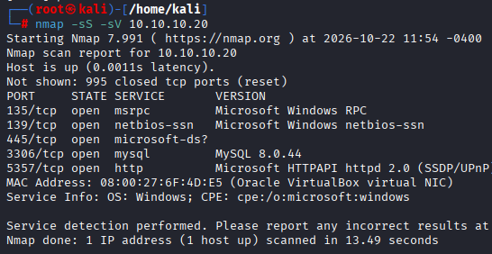


#### Sysmon Evidence

Sysmon recorded inbound network activity generated during the scan.

Relevant details included:

- **Event ID:** `3` — Network Connection
- **Source IP:** `10.10.10.30`
- **Destination IP:** `10.10.10.20`
- **Protocol:** `tcp`
- **Initiated:** `false`
- **Destination Port:** `5357`
- **Process:** `System`

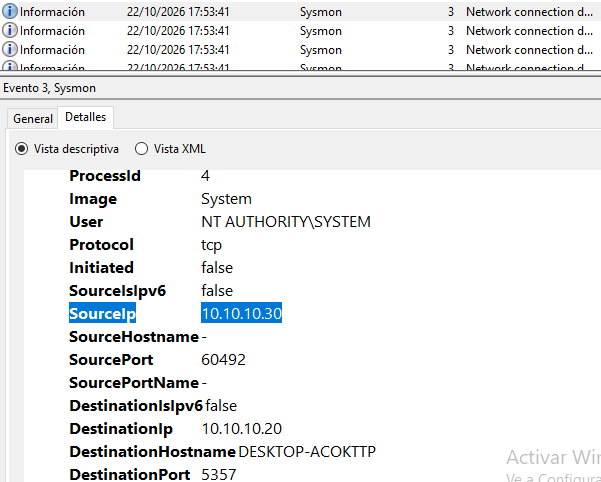


#### Wazuh Evidence

The Sysmon network event was successfully ingested by Wazuh and was visible in the `wazuh-archives-*` index.

Relevant fields included:

- Agent: `Windows10-CyberLab`
- Source IP: `10.10.10.30`
- Destination IP: `10.10.10.20`
- Destination Port: `5357`
- Protocol: `tcp`
- Initiated: `false`
- Channel: `Microsoft-Windows-Sysmon/Operational`

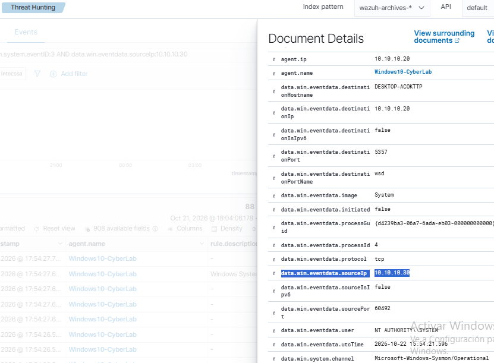


#### MITRE ATT&CK Mapping

- **Tactic:** Discovery
- **Technique:** `T1046` — Network Service Discovery


#### Observation

This scenario demonstrated how network service discovery activity can leave observable network telemetry on the targeted endpoint.

The Nmap scan was intentionally generated from the Kali Linux system at `10.10.10.30`. Sysmon Event ID `3` recorded network connections received by the Windows endpoint, while Wazuh centralized the resulting telemetry for investigation.

The individual Sysmon event shown in this lab represents supporting evidence of network activity rather than an automatic detection of a port scan.

The `T1046 — Network Service Discovery` mapping is based on the controlled behavior performed with Nmap. Identifying scanning behavior from telemetry alone would normally require correlation of multiple connection events, ports, hosts, timing, and other contextual indicators.

This distinction highlights the difference between collecting network telemetry and detecting a behavioral pattern.


---


### 6. Privileged Group Modification


#### Activity

The local account `LabUser` was added to the local Administrators group on the monitored Windows 10 endpoint.

Because the operating system language was Spanish, the local Administrators group appeared as `Administradores`.

The following command was used:

```cmd
net localgroup Administradores LabUser /add
```

After validating the activity, the change was reverted with:

```cmd
net localgroup Administradores LabUser /delete
```


#### Windows Security Evidence

Windows Security generated **Event ID 4732**, which indicates that a member was added to a security-enabled local group.

Relevant details included:

- **Event ID:** `4732`
- **Target Group:** `Administradores`
- **Target Domain:** `Builtin`
- **Target SID:** `S-1-5-32-544`
- **Member:** `LabUser`
- **Action:** Member added to a local security-enabled group

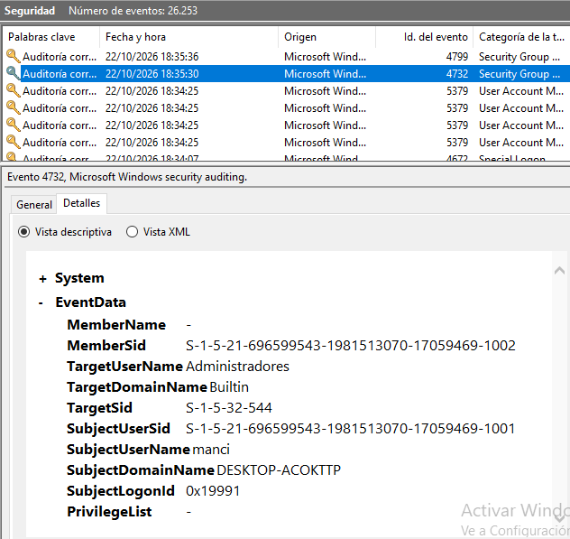


#### Wazuh Evidence

The group membership modification event was successfully ingested by Wazuh.

Relevant fields included:

- Agent: `Windows10-CyberLab`
- Event ID: `4732`
- Target Group: `Administradores`
- Subject User: `manci`
- Member SID: Local account SID associated with `LabUser`
- Channel: `Security`

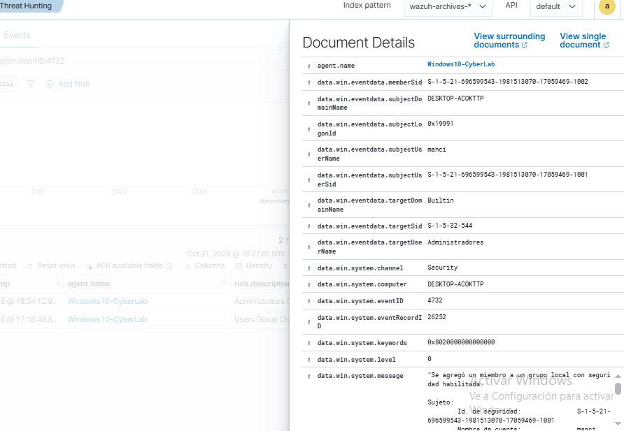


#### Wazuh Alert Evidence

Wazuh generated an alert for Windows Security Event ID `4732`, confirming that the controlled modification of the local Administrators group triggered a detection rule.

**Alert Details:**

- **Rule ID:** `60154`
- **Rule Description:** `Administrators Group Changed`
- **Rule Level:** `12`
- **Windows Event ID:** `4732`
- **Index:** `wazuh-alerts-*`
- **Agent:** `Windows10-CyberLab`
- **Target Group:** `Administradores`
- **Event Channel:** `Security`

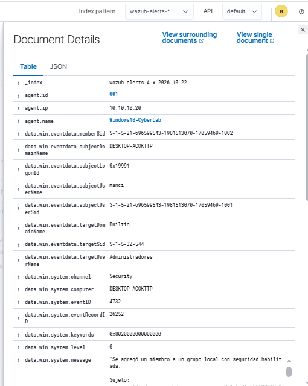

#### Detection Rule & MITRE ATT&CK Analysis

Wazuh triggered its predefined rule `60154`, which identifies changes involving the Administrators group.

The rule automatically associated the event with `T1484 - Domain Policy Modification`.

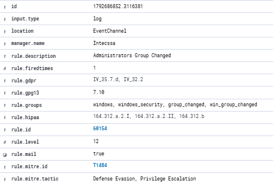

*Wazuh alert rule details showing Rule ID 60154, severity level 12, and the automatically assigned MITRE ATT&CK mapping T1484.*

However, the controlled activity performed in this lab consisted of adding a local account to the Windows Administrators group, rather than modifying domain policy.

Based on the observed behavior, `T1098.007 - Additional Local or Domain Groups` is a more precise MITRE ATT&CK mapping.

**Analyst Assessment:**

The alert represents a security-relevant privileged group membership change. Although Wazuh assigned a high alert level, the activity was authorized and performed in an isolated laboratory.

This scenario demonstrates the importance of reviewing detection rules, validating MITRE ATT&CK mappings, and interpreting alerts within their operational context rather than relying solely on automated classifications.


- **Analyst Verdict:** True Positive — Authorized Lab Activity


#### MITRE ATT&CK Mapping

- **Tactic:** Persistence / Privilege Escalation
- **Technique:** `T1098` — Account Manipulation
- **Sub-technique:** `T1098.007` — Additional Local or Domain Groups


#### Observation

This scenario demonstrated how changes to privileged local group membership can be monitored using Windows Security events and centralized through Wazuh.

Adding an account to the local Administrators group is a security-sensitive action because it grants elevated privileges to that account.

Windows Event ID `4732` provides valuable visibility into local group membership changes, including the affected group, the account responsible for the modification, and the member that was added.

In a production environment, unexpected modifications to privileged groups should be investigated because they may indicate unauthorized privilege escalation or persistence activity.

Unlike scenarios where only raw telemetry was available, this privileged group modification also generated a Wazuh alert, demonstrating the distinction between event collection and rule-based alert generation.


---


## MITRE ATT&CK Summary

The following table summarizes the MITRE ATT&CK techniques associated with the controlled activities performed during the lab.


| # | Detection Scenario | MITRE ATT&CK | Tactic |
|---|---|---|---|
| 1 | PowerShell Execution | `T1059.001` — PowerShell | Execution |
| 2 | Local Account Discovery | `T1087.001` — Local Account | Discovery |
| 3 | Local User Creation | `T1136.001` — Local Account | Persistence |
| 4 | Failed Logon Attempts | Not mapped | Authentication Monitoring |
| 5 | Network Service Discovery | `T1046` — Network Service Discovery | Discovery |
| 6 | Privileged Group Modification | `T1098.007` — Additional Local or Domain Groups | Persistence / Privilege Escalation |


### Mapping Considerations

MITRE ATT&CK mappings in this project are based on the behavior performed during each controlled scenario rather than assuming that every collected event represents malicious activity.

PowerShell, `net user`, and local group management commands are legitimate administrative tools. Their security relevance depends on the context in which they are executed.

The failed logon scenario was intentionally not mapped to `T1110 — Brute Force`, because the test consisted of only a small number of manually generated authentication failures and did not reproduce an actual password-guessing attack.

The `T1046 — Network Service Discovery` mapping is based on the controlled Nmap activity performed during the lab. The individual Sysmon network events provide supporting telemetry, but do not independently identify or classify a port scan.

Similarly, the `T1098.007 — Additional Local or Domain Groups` mapping reflects the addition of `LabUser` to the local `Administradores` group. Windows Security Event ID `4732` and the corresponding Wazuh event provide the supporting evidence for that behavior.

This approach avoids over-classifying benign telemetry and reflects how MITRE ATT&CK can be used as an analytical framework rather than simply assigning techniques to every security event.


---


## Key Findings & Lessons Learned

This lab provided practical experience with the complete monitoring workflow, from endpoint activity generation to centralized analysis in Wazuh.

Key takeaways from the project include:

- **Telemetry and alerts are not the same thing.**  
  Wazuh can ingest useful security events without necessarily generating a dedicated alert. Raw events available in `wazuh-archives-*` were essential for investigating benign but security-relevant activity.

- **Sysmon adds valuable endpoint visibility.**  
  Process creation and network connection events provided detailed context that was not always available through standard Windows logs alone.

- **Windows Security logs remain critical for account and authentication monitoring.**  
  Events such as `4625`, `4720`, and `4732` provided high-value information about failed logons, account creation, and privileged group modifications.

- **Context is essential when analyzing events.**  
  Legitimate tools such as PowerShell, `net`, and Nmap can generate activity that resembles attacker behavior. Events should therefore be interpreted together with user activity, source systems, command lines, and surrounding telemetry.

- **MITRE ATT&CK is most useful as an analytical framework.**  
  Techniques were mapped based on observed behavior rather than automatically assuming that every event represented malicious activity.

- **Centralized logging improves investigation efficiency.**  
  Wazuh made it possible to review endpoint telemetry from different sources within a single platform and correlate events more effectively.


---


## Future Improvements

Possible improvements for future versions of the lab include:

- Create custom Wazuh detection rules for selected behaviors observed during the lab.
- Generate alerts for repeated failed authentication attempts.
- Add PowerShell Script Block Logging for deeper PowerShell visibility.
- Expand Sysmon coverage with a more advanced configuration.
- Create detection logic for suspicious local account creation.
- Improve privileged group membership alert investigation with rule tuning, contextual analysis, and false-positive assessment.
- Add dashboards focused on authentication, process creation, and network activity.
- Extend the lab with additional Windows endpoints or Active Directory.
- Introduce controlled attack simulations and compare the generated telemetry with MITRE ATT&CK techniques.


