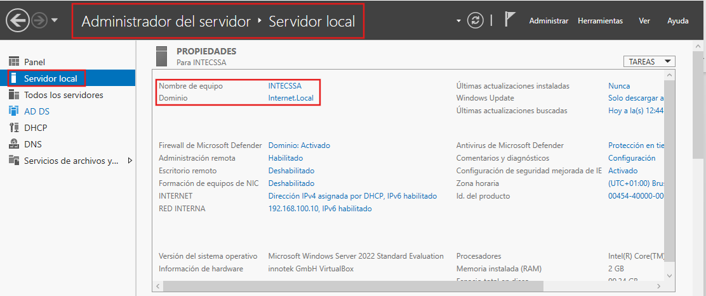
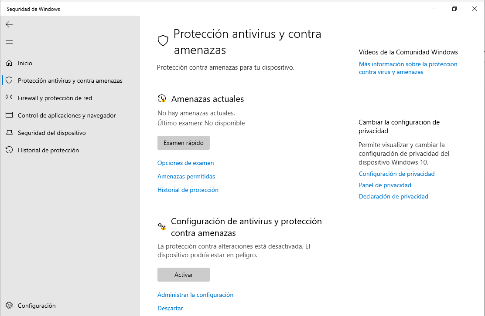
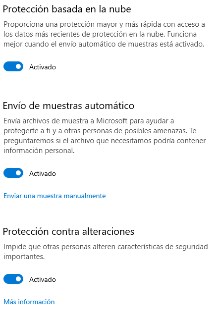
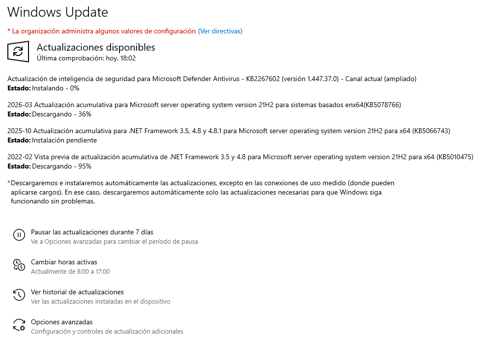
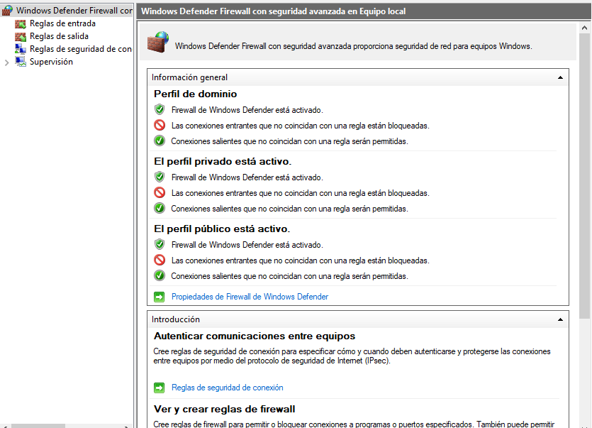
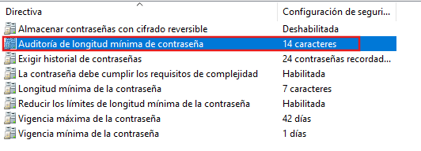
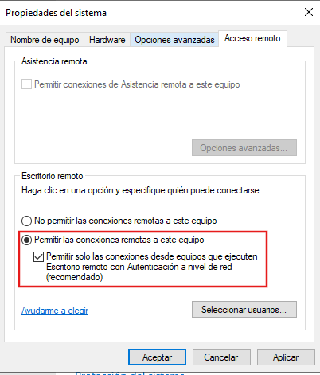
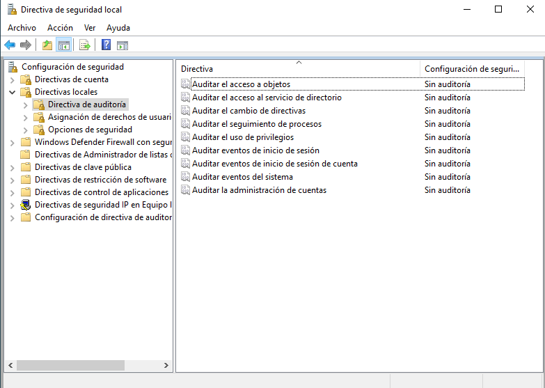
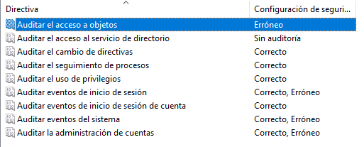

# Windows Server 2022 Hardening — Defensive Security Lab

## Overview

This project documents a hands-on Windows Server 2022 hardening exercise performed in a controlled virtualized environment.

The server was configured as a Domain Controller and reviewed from a defensive security perspective, with the objective of reducing attack surface, strengthening system protections, and improving security monitoring.

The hardening process included Microsoft Defender configuration, Windows Update, firewall review, password policy analysis, Remote Desktop hardening, and security auditing.

## Contents

- [Scope](#scope)
- [Lab Environment](#lab-environment)
- [Initial Security Baseline](#initial-security-baseline)
- [Microsoft Defender Hardening](#microsoft-defender-hardening)
- [Windows Update & Patch Management](#windows-update--patch-management)
- [Windows Defender Firewall Hardening](#windows-defender-firewall-hardening)
- [Password Policy Review](#password-policy-review)
- [Remote Desktop Protocol Hardening](#remote-desktop-protocol-rdp-hardening)
- [Security Audit Policy Configuration](#security-audit-policy-configuration)
- [Hardening Summary](#hardening-summary)
- [Conclusion](#conclusion)
- [Lessons Learned](#lessons-learned)

## Scope

The project focused on reviewing and improving the security posture of a Windows Server 2022 system.

The assessment included:

- Initial security baseline review
- Microsoft Defender configuration
- Windows Update and patch management
- Windows Defender Firewall review
- Password policy analysis
- Remote Desktop Protocol hardening
- Security audit policy configuration

The project was performed entirely within a controlled lab environment using Oracle VirtualBox.

## Lab Environment

The hardening exercise was performed in a virtualized Windows Server environment.

### Environment Details

- **Operating System:** Windows Server 2022 Standard Evaluation
- **Role:** Domain Controller
- **Domain:** `Internet.Local`
- **Virtualization:** Oracle VirtualBox
- **Network Mode:** Bridged Adapter
- **Administrative Access:** Dedicated administrative account

## Initial Security Baseline

Before applying any hardening measures, the server configuration was reviewed to establish an initial security baseline.

The review included the following areas:

- Microsoft Defender Firewall status
- Remote management configuration
- Remote Desktop availability
- Network interface configuration
- Windows Update status
- Microsoft Defender Antivirus protection
- Internet Explorer Enhanced Security Configuration
- General server security posture

  

*Initial Windows Server 2022 baseline review showing the server role, firewall status, remote management configuration, update state, and other security-relevant settings.*

### Baseline Observations

The initial review identified the following relevant conditions:

- Microsoft Defender Firewall was enabled for the domain profile
- Remote management was enabled
- Remote Desktop configuration was reviewed as part of the baseline
- Real-time Microsoft Defender Antivirus protection was enabled
- Windows Update had pending updates
- Internet Explorer Enhanced Security Configuration was enabled
- The server had both external and internal network interfaces configured

## Microsoft Defender Hardening

Microsoft Defender Antivirus was reviewed to identify protection features that were enabled or disabled in the initial server configuration.

The initial review showed that real-time protection was active, but some defensive controls were not fully enabled.

### Initial State

The following conditions were observed:

- No active threats were detected
- No previous security scan had been performed
- Tamper Protection was disabled

Tamper Protection helps prevent unauthorized changes to important Microsoft Defender security settings, making it an important hardening control.

  

*Initial Microsoft Defender configuration showing no active threats and Tamper Protection disabled before the hardening process.*

### Hardening Actions

The security configuration was reviewed and additional Microsoft Defender protections were enabled.

A quick security scan was also performed to validate the current system state.

### Result

After the hardening process:

- Microsoft Defender protections were enabled
- Security intelligence was updated
- No active threats were detected
- Tamper Protection was enabled

This configuration improved the server's endpoint protection posture and reduced the possibility of unauthorized modification of security controls.

  

*Post-hardening Microsoft Defender configuration showing real-time protection, cloud-delivered protection, automatic sample submission, and Tamper Protection enabled.*

## Windows Update & Patch Management

The server's update status was reviewed as part of the hardening process to identify missing security and system patches.

### Initial State

Windows Update showed several pending updates, including:

- Microsoft Defender security intelligence updates
- Cumulative Windows Server updates
- Microsoft Malicious Software Removal Tool updates
- .NET Framework updates

Leaving these updates pending can increase exposure to known vulnerabilities and outdated system components.

### Hardening Actions

The available updates were reviewed and the installation process was initiated to bring the server closer to a fully patched state.

This included:

- Security intelligence updates
- Cumulative operating system patches
- .NET Framework updates
- Malware removal tool updates

  

*Windows Update applying security intelligence, cumulative system, and .NET Framework updates as part of the server hardening process.*

### Result

The server entered the update installation process, reducing the risk associated with unpatched components and outdated security definitions.

Regular patch management is an essential part of system hardening and should be maintained as an ongoing operational process.

## Windows Defender Firewall Hardening

Windows Defender Firewall was reviewed to verify that the server was protected across all available network profiles.

### Initial State

The firewall configuration showed that:

- The Domain profile was enabled
- The Private profile was enabled
- The Public profile was enabled

Advanced firewall settings were then reviewed to confirm the default traffic policy.

### Hardening Validation

The following configuration was verified across the active profiles:

- Inbound connections were blocked by default
- Outbound connections were allowed
- Firewall protection was enabled

This configuration helps reduce unnecessary network exposure by preventing unsolicited inbound traffic unless explicitly permitted by a firewall rule.

  

*Windows Defender Firewall advanced settings showing active Domain, Private, and Public profiles, with unsolicited inbound connections blocked by default and outbound traffic allowed.*

### Result

The firewall configuration was considered appropriately hardened for the laboratory environment.

Keeping inbound traffic restricted by default reduces the attack surface and ensures that only explicitly authorized services can accept external connections.

## Password Policy Review

The server's password policy configuration was reviewed to evaluate whether authentication requirements were aligned with secure administrative practices.

### Initial State

The local password policy settings were already being controlled by a higher-level policy.

Because of this, the local security policy could not directly override the configured values.

The existing policy was reviewed to confirm that password security requirements were already being enforced.

### Hardening Actions

As part of the review, the minimum password length auditing value was configured to **14 characters**.

This allows administrators to evaluate whether existing passwords meet stronger length requirements and supports future password policy improvements.

  

*Password policy review showing minimum password length auditing configured to 14 characters while the server remained governed by centrally managed password controls.*

### Result

The server remained governed by the higher-level password policy while additional password length auditing was enabled.

This strengthened visibility into password quality without overriding centrally managed security controls.

## Remote Desktop Protocol (RDP) Hardening

Remote Desktop configuration was reviewed because RDP represents a common attack surface in Windows environments when exposed unnecessarily.

### Initial State

The server configuration showed that:

- Remote Desktop was enabled
- Remote connections to the server were allowed
- Network Level Authentication (NLA) was enabled
- Remote Assistance was disabled

Although NLA provides an additional security layer, an enabled RDP service still increases the server's exposed attack surface.

  

*Initial Remote Desktop configuration showing RDP enabled with Network Level Authentication (NLA) active before the service was disabled as part of the hardening process.*

### Hardening Actions

Remote Desktop access was disabled completely as it was not required for the laboratory environment.

This removed unnecessary remote access functionality and reduced exposure to:

- Brute-force attacks
- Credential attacks
- Port scanning
- Vulnerabilities affecting remote access services

### Result

The server was configured to no longer accept Remote Desktop connections.

Disabling an unnecessary remote service reduced the attack surface and improved the overall hardening posture of the system.

## Security Audit Policy Configuration

Security auditing was reviewed to determine whether the server was generating sufficient logs for monitoring and incident investigation.

### Initial State

The audit policy settings were configured as **No Auditing**, meaning that important security events were not being recorded.

This limited the server's ability to detect or investigate:

- Unauthorized access attempts
- Failed authentication events
- Changes to system configuration
- Suspicious administrative activity

  

*Initial audit policy configuration showing security events set to “No Auditing,” limiting visibility into authentication activity and system changes.*

### Hardening Actions

Security auditing was enabled to record both successful and failed security events.

This configuration improves visibility into system activity and provides useful evidence for:

- Security monitoring
- Incident detection
- Troubleshooting
- Post-incident analysis

### Result

The server was configured to generate security audit events for both successful and failed actions.

Enabling audit logging significantly improved the server's monitoring capabilities and strengthened its overall defensive security posture.

  

*Post-hardening audit policy configuration with successful and failed security events enabled to improve monitoring, detection, and incident investigation.*

## Hardening Summary

The hardening process improved the overall security posture of the Windows Server 2022 environment by reducing unnecessary exposure, strengthening endpoint protections, and increasing security visibility.

### Key Improvements

- Microsoft Defender protections reviewed and strengthened
- Security intelligence and system updates applied
- Windows Defender Firewall validated across all profiles
- Inbound traffic restricted by default
- Password policy configuration reviewed
- Minimum password length auditing configured
- Remote Desktop disabled when not required
- Security auditing enabled for successful and failed events

### Final Security Posture

After applying the hardening measures, the server presented a more controlled and defensive configuration.

The main improvements focused on:

- Reducing attack surface
- Improving patch and endpoint protection
- Strengthening access controls
- Limiting unnecessary remote services
- Increasing logging and monitoring capabilities

The resulting configuration provides a stronger baseline for operating Windows Server systems in a controlled enterprise environment.

## Conclusion

This project demonstrated a structured hardening process for a Windows Server 2022 environment configured as a Domain Controller.

The assessment and configuration review covered several critical security areas, including endpoint protection, patch management, firewall configuration, password policy, Remote Desktop exposure, and security auditing.

The applied hardening measures reduced unnecessary attack surface, strengthened defensive controls, and improved the server's ability to detect and record security-relevant activity.

The resulting configuration provides a stronger and more controlled baseline for operating Windows Server systems in a security-conscious enterprise environment.

## Lessons Learned

This project reinforced several important principles of Windows Server hardening and defensive security:

- Hardening should begin with a clear security baseline before making configuration changes
- Reducing attack surface is often as important as adding new security controls
- Patch management and endpoint protection must be treated as continuous processes, not one-time actions
- Firewall configuration should follow a restrictive approach, allowing only necessary inbound traffic
- Centrally managed policies should be respected instead of being overridden locally without understanding their source
- Remote services such as RDP should only remain enabled when there is a clear operational requirement
- Security auditing is essential for detection, troubleshooting, and post-incident investigation
- Hardening is most effective when preventive controls and monitoring capabilities are improved together

The project also highlighted that secure system administration is not only about enabling protections, but about understanding which services, permissions, and configurations are actually necessary for the environment.

